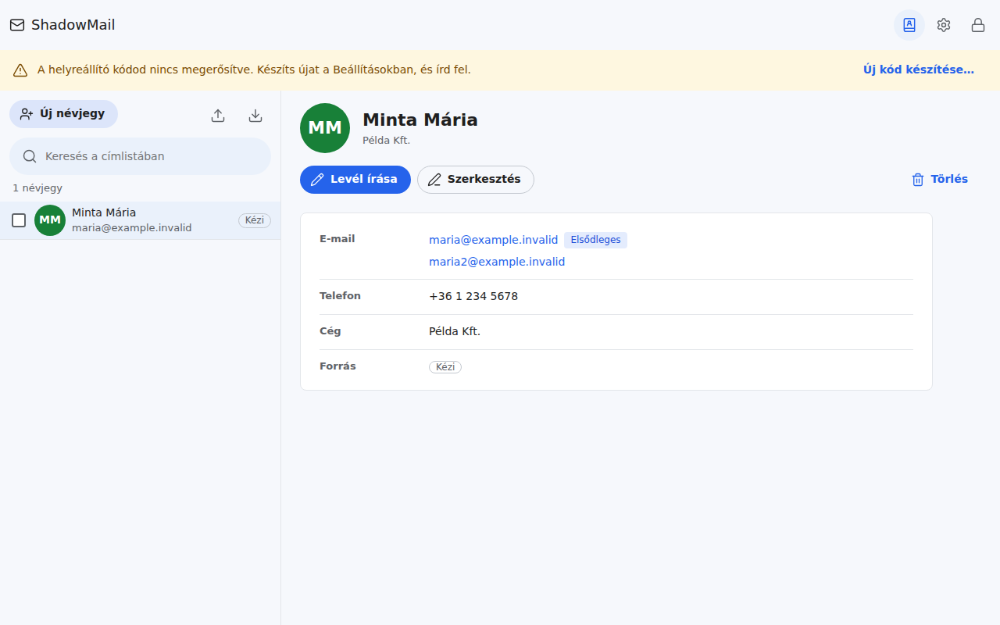
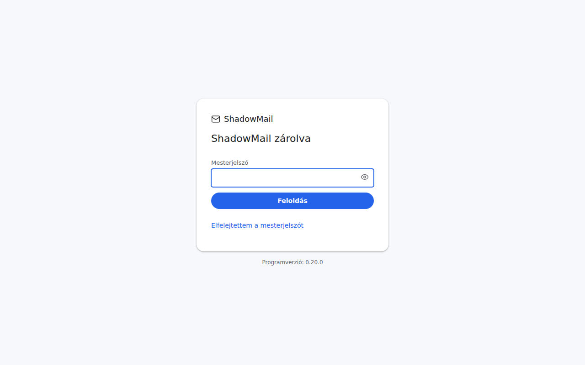
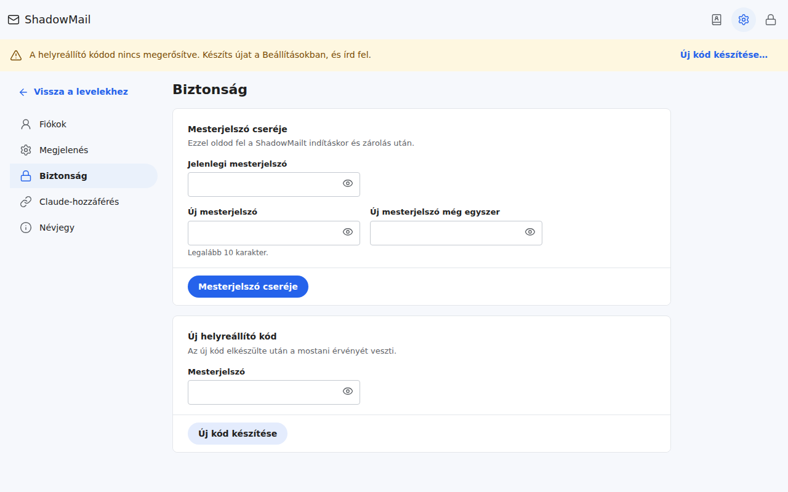

# ShadowMail

[English version](README.md)

Hordozható levelezőprogram Windowsra. Nem kell telepíteni: egy mappába kicsomagolva fut, és **minden adatát
a program melletti `data` mappában tartja** (fiókok, letöltött levelek, keresőindex, beállítások). A gépen
máshová (AppData, Temp, registry) nem ír. Két kivétel. Ha a program pendrive-ról (FAT/exFAT) fut, egy
melléklet **Megnyitás**-a a Windows ideiglenes mappájába (`%TEMP%\ShadowMail\…`) kerül, mert csak ott
jelölhető internetről származónak (lásd Biztonság röviden); a program induláskor és kilépéskor kiüríti. És a
Windows saját **Megnyitás/Mentés** ablaka megjegyzi a felhasználói registryben, melyik mappát használtad benne
utoljára (`HKCU\…\Explorer\ComDlg32\LastVisitedPidlMRU`, egy bejegyzés a `ShadowMail.exe` nevével): ezt a
Windows írja, nem a program. A Windows „Legutóbbi fájlok” listájába a ShadowMail nem tesz bejegyzést.


(A képek tesztadattal készültek: `node scripts/ui-screenshots.mjs readme --set readme --out docs/screenshots`.)

## Funkciók

- IMAP- és POP3-fiókok, több fiók egy programban.
- Levelek olvasása: biztonságos HTML-megjelenítés, a külső képek csak kérésre, mellékletek.
- Keresés minden fiókban (ékezet nélkül is), szűrők a mappanézetben is.
- Levélírás és küldés (SMTP), válasz, továbbítás, mappakezelés.
- **Címlista**: névjegyek, vCard- és CSV-import és -export.
- A levél **fejléceinek és eredeti forrásának** megtekintése.
- **Claude-hozzáférés** (alapból kikapcsolva; lásd lent).
- **Magyar vagy angol** felület, öt **téma** (két sötét és két tömör, "klasszikus"), az olvasópanel jobbra, alul vagy
  sehol, egy gombbal váltható a fejlécben.
- **Kép a szöveges aláírás alatt**, fiókonként.
- A fiókok és a mappák **saját sorrendben** (húzással, menüből vagy billentyűvel).
- Windowson az olvasatlan levelek száma piros karikában a tálca-ikonon (minden fiók Beérkezett mappája együtt, 99 fölött "99+", zárolva nincs); kikapcsolható: Beállítások / Megjelenés.
- Minden adat titkosítva, mesterjelszóval (lásd Első indítás).


### Billentyűk megnyitott levélnél

- **Le** / **Fel**: a lista következő / előző levele (a lista mostani sorrendjében és szűrésével; keresésnél a
  találatok sorrendjében). A levél szövegét a **PageUp**, **PageDown** és a **Szóköz** görgeti.
- **Delete**: törlés, **End**: archiválás (a fiók Archívum-mappájába, évenkénti módban az év mappájába). Ha van
  látható kijelölés a listában, azokra hat, különben a megnyitott levélre. Az olvasó eszköztárában a Törlés mellett
  **Archiválás** gomb is van. Nyitott levél nélkül a Delete a látható kijelölést törli, az End a lista végére görget.
- Törlés, archiválás vagy áthelyezés után a lista **következő** (alatta lévő) levele nyílik meg; ha az volt az utolsó,
  az előző.
- Ahol nincs hova archiválni (a fióknak nincs Archívum-mappája, vagy a levél már ott van), az End nem csinál semmit,
  csak egy sor mondja meg, miért.
- A billentyűk akkor is működnek, ha a levél szövegébe kattintottál. Szövegmezőben, menüben, párbeszédablakban és a
  panelek elválasztóján a megszokott jelentésük marad.

### Szűrők

A kereső melletti **Szűrők** gomb nyitja a szűrősort. Keresőszó nélkül a megnyitott mappa listáját szűri:
**Olvasatlan**, **Van melléklet**, **Csillagos**, **Bármikor** (dátumtól, dátumig). A számláló ilyenkor
így mutatja: "1–12 / 28 (szűrve, összesen 124)". Keresőszóval ugyanezek a találatokat szűrik.

- A szűrő **másik mappára váltva is megmarad**, és amíg él, a szűrősor látszik. Mindet a **Szűrők
  törlése** gomb kapcsolja ki (a lista fejlécében, és üres szűrt listánál alatta). Az Esc a keresőmezőben
  csak a keresést hagyja el, a szűrőket nem.
- A "mindet kijelöl" és a Ctrl+A **csak a szűrt leveleket** jelöli ki, a törlés is csak azokra hat.
- Az Olvasatlan szűrőben megnyitott levél olvasott lesz, de a listában marad, amíg szűrőt, mappát vagy
  rendezést nem váltasz, vagy nem nyomod meg a **Frissítés**t.
- A **Fiók** chip a választott fiók Beérkezett mappáját nyitja meg, a **Mappa** chip a választott mappát;
  a **Rendezés** chip ugyanaz, mint a lista **További** menüjének rendezése.

### Címlista

A fejléc **Címlista** gombja (a Beállítások mellett) nyitja a névjegyeket; újra megnyomva vissza a levelekhez.

- **Kik kerülnek be maguktól:** akinek levelet küldesz (Címzett, Másolat, Titkos másolat), az **Automatikus**
  névjegyként bekerül. A kapott levelek feladói maguktól nem kerülnek be: egy megnyitott levélnél a feladó neve
  mellett a **Címlistához ad** gombbal veheted fel (a saját címednél ez nem jelenik meg).
- **Névjegy:** megjelenített név, utónév, vezetéknév, cég, beosztás, megjegyzés, több e-mail cím (egy elsődleges)
  és több telefonszám. **Új névjegy**, **Szerkesztés**, **Törlés**; a **Levél írása** az elsődleges címre nyit
  levelet. Egy cím csak egy névjegyhez tartozhat.
- **Törlés:** a törölt névjegy címe a következő küldéskor **nem kerül vissza** magától (kézzel újra felveheted).
  A címkiegészítés sem ajánlja, amíg vissza nem veszed.
- **Importálás…:** vCard (`.vcf`, 2.1, 3.0, 4.0) vagy CSV (a Google és az Outlook oszlopaival, magyar Outlookét
  is), legfeljebb 10 MB és 10 000 névjegy. Előbb **előnézet** jön: hány új, hány összevont (ugyanaz a cím egy
  meglévő névjegynél: a meglévő adatok maradnak, csak az üres mezők töltődnek), hány változatlan és hány hibás
  sor; a figyelmeztetések (például 20-nál több cím egy névjegyben) külön. Csak a jóváhagyás után ír, egyetlen
  lépésben. A fényképek és a webcímek nem kerülnek be; a többi, itt nem szerkeszthető vCard-adat megmarad, és
  exportkor visszamegy.
- **Exportálás:** az összes vagy a kijelölt névjegyek vCard (3.0) vagy CSV (Google-formátum) fájlba. A CSV-ben a
  képletként értelmezhető cellák (`=`, `+`, `-`, `@` kezdet) egy `'` jelet kapnak, hogy egy táblázatkezelő ne
  futtassa őket; a `+36…` alakú telefonszám kivétel.
- Hálózat nincs: az import és az export csak helyi fájllal dolgozik. A címlista a titkosított adatbázisban van.



### Fejlécek és a levél forrása

Egy megnyitott levél **További** menüjében:

- **Fejlécek:** összefoglaló (Feladó, Címzett, Másolat, Dátum, Tárgy, Message-ID) és a fogadó szerver
  ellenőrzésének eredménye (**SPF**, **DKIM**, **DMARC**: zöld, ha megfelelt, piros, ha nem, szürke minden
  más esetben), alatta a nyers fejlécek. Az eredményt a program **nem maga ellenőrzi**: a legfelső
  `Authentication-Results` sorból olvassa, amit a levelet fogadó szerver írt; ezért csak tájékoztató.
- **Eredeti megjelenítése:** a levél teljes forrása szövegként (kb. 2 millió karakterig; a nagyobbnak a vége nem
  látszik, de mentéskor a teljes levél megy). A láthatatlan és vezérlőkarakterek jelölve (`⟨U+202E⟩` alakban), a
  levél HTML-je és képei itt soha nem jelennek meg.
- **Mentés .eml-ként:** a teljes, eredeti levél fájlba (a fájlnév a tárgyból); a mentett fájlt a program
  internetről származónak jelöli (lásd Biztonság röviden).


### Megjelenés

A **Beállítások / Megjelenés** alatt:

- **Nyelv / Language**: Magyar vagy English, azonnal érvényes. Választás nélkül a program magyar, a Windows nyelvétől
  függetlenül. A Claude-nak menő szövegek (Claude-hozzáférés) magyarok maradnak.
  A nyitott levélíró ablakok előbb elmentik a piszkozatukat és bezárulnak (amelyiknek a mentése nem sikerül, nyitva
  marad), utána a főablak az új nyelven töltődik újra.
- **Téma**: Alap (világos), Sötét, Grafit, Klasszikus kék, Klasszikus világos. A két klasszikus témában kisebbek a
  sorok és a gombok; a választásuk egyszer az olvasópanelt is beállítja (Klasszikus kék: jobbra, Klasszikus világos:
  alul). A levél saját HTML-je minden témában fehér háttéren látszik.
- **Olvasópanel**: jobbra a lista mellett, alul a lista alatt, vagy nincs (a levél a lista helyén nyílik). A
  fejléc **elrendezés-gombja** sorban váltja a hármat.
- **Olvasatlan levelek száma a tálca-ikonon** (Windows): alapból bekapcsolva.

### Képes aláírás

A **Beállítások / Fiókok** alatt, egy mentett fióknál: a **Kép feltöltése…** egy PNG- vagy JPG-képet tesz a szöveges
aláírás alá (legfeljebb 800 x 400 képpont és 150 KB; a program nem méretezi át). A kép metaadatait (például a
GPS-helyet vagy a szerzőt) mentéskor eltávolítja; az elforgatás-jelzős képet nem fogadja el (mentsd el elforgatva,
és töltsd fel újra). Új levélben a kép az aláírás szövege alatt látszik, és a levélben megy ki (nem webcímre mutató
hivatkozásként). A Feladó-fiók váltása csak az aláírás blokkját cseréli, a begépelt szöveg marad.

### A fiókok és a mappák sorrendje

- Egy mappát a testvérei (az azonos szülőjű mappák) közé húzhatsz, egy fiók fejlécét a többi fiók közé. A húzás
  soha nem tesz egy mappát egy másikba, és mappát mappára ejtve egy levél sem mozdul.
- Ugyanez a jobb gombos menüből (**Feljebb**, **Lejjebb**), vagy **Alt+Fel** / **Alt+Le** billentyűvel a
  billentyűfókuszban lévő mappán vagy fiókfejlécen.
- A fiók jobb gombos menüjének **Mappák betűrendbe** pontja visszaadja a mappái eredeti sorrendjét.
- A sorrendet csak a ShadowMail tartja: a szerveren és más levelezőprogramokban nem változik semmi. Az átnevezett
  mappa a helyén marad, az új mappa a listája végére kerül.

### Újdonságok a 0.15.0-ban, ismert korlátok

- **Mappaszerepek kézzel:** a Beállítások / Fiókok / egy IMAP-fiók szerkesztőjében a Piszkozatok, az Elküldött, a
  Kuka, a Levélszemét és az Archívum mappa kiválasztható; az "Automatikus" a program saját döntése. A választás
  azonnal érvényes, a szerveren semmi nem változik.
- **Archiválás évenként:** ha az Archívum alatt évszámos almappák vannak (vagy a fiókban ez van beállítva), az
  Archiválás a levelet a saját évének mappájába teszi, a hiányzó év-mappát létrehozza.
- **Almappák csukása a bal sávban,** a csukott mappa száma az almappák olvasatlanjait is mutatja.
- **Mappák feliratkozása:** IMAP-fióknál csak a szerveren feliratkozott mappák látszanak; a fiók menüjében
  ("Mappák feliratkozása…") és a mappa menüjében (Leiratkozás) állítható. Frissítés után semmi nem tűnik el.
- **Billentyűk megnyitott levélnél:** Le/Fel a következő/előző levél, Delete törlés, End archiválás; törlés vagy
  archiválás után a következő levél nyílik.
- **Új fióknál a típust (IMAP vagy POP3) választani kell;** eddig is választható volt, csak előre ki volt jelölve
  az IMAP.
- **Egységes űrlapok:** a fiókszerkesztő, a Címlista, a Megjelenés és a Biztonság új elrendezést kapott (szakaszok,
  a tartalomhoz illő mezők, a Mentés gomb mindig látszik; a Címlistában a vezetéknév elöl, az elsődleges cím
  rádiógombbal).

A kiadás ismert korlátai:

- Ha egy évenkénti archiválásnál a második áthelyezés a szerveren elbukik, a lista csak a következő szinkronnál
  frissül; egy már létező év-mappánál a szerver "a mappa már létezik" hibát adhat.
- Nagyon terhelt gépen egy-egy nagy levél szövege nem kerül a keresőbe (a 0.12.0 óta így van).
- A lista helyén megnyitott levél törlése után a következő levél nyílik meg, nem a lista.
- A fiókszerkesztő Archiválás-menüje a hosszú választást levágja; 860 px széles ablakban a Címlista
  szerkesztőjének címoszlopa keskeny.
- A Windows-csomagot (ZIP) a kiadás előtt Windowson ellenőrizzük; a valódi Windows-tálcát és a billentyűket egy
  megnyitott HTML-levél belsejében Linuxon nem mértük.

### Újdonságok a 0.14.1-ben, ismert korlátok

A 0.14.1 javító kiadás:

- **Mappaszerepek több program által használt postafiókon.** Ha a szerver nem jelöli, melyik mappa az Elküldött, a
  Lomtár, a Piszkozatok és a Levélszemét, a 0.14.0 a nevek közül ábécérendben az elsőt választotta. Így egy fiókban,
  ahol a "Sent" mellett egy másik program "Elküldött elemek" mappája is ott van, a gyári Elküldött a szinte üres
  mappára mutatott. Most a szerver saját jelzője dönt; ha nincs, a több levelet tartalmazó mappa nyer, és a
  választás megmarad. A javítás a frissítés utáni első teljes szinkronnal lép életbe.
- **Nagyobb szám a tálca-ikonon:** a számjegy a karika kb. fele, simított, élénkebb piros alapon.
- **Az új levél ablaka** a főablak monitorán, a főablak közepén nyílik (eddig mindig az elsődleges kijelzőn).

A kiadás ismert korlátai:

- A 0.14.0 küldés közben a levél másolatát, törléskor a levelet a rossz mappába (például "Elküldött elemek",
  "Törölt elemek") tette a szerveren. Ezek a levelek **ott maradnak**: a 0.14.1 a szerveren semmit nem mozgat, kézzel
  áthelyezhetők.
- A **valódi Windows-tálcát** és a **két monitoros** elrendezést a kiadás előtt nem mértük; csak a program által
  rajzolt képet és a hely számítását.
- 125%-os második kijelzőn az új levél ablaka néhány képponttal kilóghat a kijelzőről (az Electron kerekítése).

### Újdonságok a 0.14.0-ban, ismert korlátok

A 0.14.0 a 0.12.0 óta elkészült mindent hozza: az angol felületet, a témákat és az elrendezés-gombot, a képes
aláírást, a fiók- és mappasorrendet, az olvasatlanok számát a tálca-ikonon, a **Szerkesztés** gombot a Piszkozatok
mappa levelein, a szűken is olvasható levéllistát, a gyorsabb mappaszámokat a bal sávban, a nagyon nagy, táblázatos
leveleken a fagyás megszűnését, és a kérdést a válasz előtt, ha egy levél írásiránya nagyon sokszor vált (lásd
"Hibás vagy káros levélre írt válasz").

A kiadás ismert korlátai:

- A 0.14.0 Windows-csomagja a kiadás előtt **nem futott**: a tesztjei Linuxon futottak (a gazda döntése).
- A **tálca-karikát valódi Windows-tálcán** nem ellenőriztük; csak a program által rajzolt képet mértük.

## Letöltés és indítás

A legújabb változat: [github.com/arnyek/ShadowMail/releases/latest](https://github.com/arnyek/ShadowMail/releases/latest)
(az Assets alatt a `ShadowMail-<verzió>-win-x64.zip` fájl).

1. A `ShadowMail-<verzió>-win-x64.zip` fájlt csomagold ki egy **helyi** mappába, például
   `D:\Programok\ShadowMail` vagy egy pendrive-ra.
2. Indítsd el a `ShadowMail.exe`-t.

### Windows SmartScreen

A program nincs digitálisan aláírva, ezért az első indításkor a Windows figyelmeztethet
("A Windows megvédte a számítógépet"). Ilyenkor: **További információ**, majd **Futtatás mindenképp**.
Ezt csak egyszer kell megtenni.

## Első indítás: a mesterjelszó

Az első indításkor egy **mesterjelszót** kell megadnod (legalább 10 karakter, kétszer). Ez titkosítja a
`data` mappában a teljes levelezést: a fiókok jelszavait, az adatbázist (levéllista, keresőindex) és a
letöltött leveleket. Minden indításkor ezzel oldod fel a programot, bármelyik gépen.



### A helyreállító kód

A mesterjelszó után a program egy **helyreállító kódot** mutat (25 karakter, ötös csoportokban, például
`7K3QD-…`). Ezzel léphetsz be, ha elfelejted a mesterjelszót. **Írd le vagy mentsd el** (**Másolás**,
**Mentés fájlba**), és tartsd biztos helyen, a géptől és a pendrive-tól külön. Továbblépni csak akkor lehet,
ha a kód egyik csoportját visszaírod. Aki a kódot megszerzi, a mesterjelszó nélkül is kinyitja a
levelezésedet. A program a kódot nem tárolja; ha elveszik, a **Fiókok és beállítások** **Biztonság** fülén az
**Új kód készítése** gomb (a mesterjelszóval) újat készít, a régi érvényét veszti a jelenlegi
`vault.json`-nal. Ha a kód-képernyő megerősítés nélkül bezárul, a következő feloldás után egy sáv emlékeztet.

A **Másolás** után a kód 60 másodpercig marad a vágólapon: utána, zároláskor és kilépéskor a program
törli, de csak akkor, ha még pontosan a kód van rajta (amit közben máshonnan másoltál, ahhoz nem nyúl).
Windowson a kód a vágólap-előzményekbe (Win+V) és a felhős vágólapra sem kerül fel.

**A régi kód és a régi jelszó egy korábbi adatmappa-mentéssel együtt továbbra is kinyitja a levelezést.** A
kódcsere, a kóddal végzett helyreállítás és a jelszócsere csak a `data\vault.json` fájlt írja át, a levelek
kulcsa ugyanaz marad. Egy korábbi `vault.json`-másolat (például egy régebbi adatmappa-mentésben) ezért a régi
kóddal vagy a régi mesterjelszóval a mostani adatbázist és leveleket is nyitja. **Ha a kód vagy a jelszó
illetéktelen kézbe került, a régi mentéseket is semmisítsd meg.**



### Ha elfelejted a mesterjelszót

A feloldó képernyőn **Elfelejtettem a mesterjelszót**, két út:

- **Van helyreállító kódom**: a kód (kis- és nagybetű, szóköz, kötőjel mindegy; I és L = 1, O = 0) és egy új
  mesterjelszó kétszer. **Semmi nem vész el.** Utána új kódot kapsz, a használt érvényét veszti a jelenlegi
  `vault.json`-nal (egy régi mentéssel lásd fent).
- **Nincs kódom**: teljes újrakezdés. **Minden helyi adat elvész**: a fiókok és a jelszavaik, a
  keresőindex, a POP3-levelek, a helyi mappák, a csak helyben lévő piszkozatok és Elküldött-másolatok. Az
  IMAP-levelek a fiók újbóli felvétele után a szerverről újra letöltődnek. A megerősítéshez a `TÖRLÉS` szót
  kell beírni, utána új mesterjelszó kétszer. A régi adat a kulcsa nélkül olvashatatlan, ezért törölhető.

**Írd fel a mesterjelszót és a kódot is biztonságos helyre.**

### Félbeszakadt újrakezdés

Ha a **Nincs kódom** újrakezdés közben a gép leáll, a program a következő indításkor maga befejezi vagy
visszacsinálja. Ha nem tudja biztosan eldönteni, hol tartott, magától nem töröl semmit: a feloldó képernyő
ezt kiírja, és felkínálja az **Újrakezdés befejezése** gombot. Ez ugyanaz, mint a **Nincs kódom** út
(`TÖRLÉS`, új mesterjelszó kétszer): **minden helyi adat törlődik**, utána üres program és új kód jön. Ha
előtte bármit meg szeretnél tartani, a program bezárása után **másold le a teljes `data` mappát**.

A **Zárolás** gomb azonnal elfelejti a kulcsot: a nyitott levélírók előbb elmentik a piszkozatukat és
bezárulnak, a szinkron leáll, az adatbázis bezárul, amíg újra fel nem oldod.

## Fiók felvétele

**Fiókok és beállítások** → **Új fiók**. Kell hozzá: a szerver neve, portja, a biztonsági mód (SSL/TLS,
STARTTLS, vagy titkosítás nélkül), a felhasználónév és a jelszó, az SMTP (küldés) adatai. A
**Kapcsolat próbája** gomb ellenőrzi, mielőtt elmented.

- **Indexelt levelek** (a Szinkronizálás szakaszban, alapból 3 év): ennél régebbi leveleknek csak a fejléce (feladó, tárgy)
  kereshető helyben; a szövegükben a keresés "Keresés a szerveren is" (IMAP) vagy "Keresés a régi levelek
  szövegében is" (POP3) gombjával lehet keresni. Amit egyszer megnyitottál, az mindig kereshető marad.
- **A helyi keresés a levél LÁTHATÓ szövegében keres**: HTML-levélnél abban, amit az olvasó is mutat (a
  rejtett előnézeti szöveg, a fehér a fehéren, a `display:none` kimarad), csak-szöveges levélnél a szövegben. A lista
  előnézetében a rejtett előnézeti szöveg látszik. Egy túl összetett HTML-levélnek csak az első 128 KB-ja kereshető;
  ha az is túl összetett, csak a tárgya és a feladója. A "Keresés a szerveren is" a SZERVER keresése a teljes
  levélben: a rejtett szövegre is találhat.
- **POP3**: a levelek alapból a szerveren maradnak; a "Törlés a szerverről N nap után" beállítással a
  program a letöltés után N nappal törli őket a szerverről (a gépen megmaradnak).
  Egyes szerverek (pl. Dovecot) a POP3-letöltéskor a levelet a szerveren olvasottnak jelölik. Ha ugyanezt
  a postafiókot IMAP-on (webmail, telefon) is nézed, ott a letöltött levelek olvasottként látszanak.
- **Hibás jelszó**: ha a szerver elutasítja a belépést, a program az adott fiókkal **nem próbálkozik újra
  magától** (sok szerver néhány hibás próba után letiltja a gépet). Javítsd a jelszót a fiók
  beállításainál, vagy nyomd meg a **Frissítés** gombot.

## Adatmappa, mentés, frissítés

Minden adat a `ShadowMail.exe` melletti `data` mappában van. **Mentés: a program bezárása után másold le
az egész `data` mappát** (például egy másik meghajtóra). Visszaállítás: a mentett `data` mappát másold a
`ShadowMail.exe` mellé.

- `data\mail.sqlite`: fiókok (titkosított jelszavakkal), levelek adatai, keresőindex
- `data\store\`: a letöltött levelek (.eml, titkosítva)
- `data\tmp\`: a megnyitott mellékletek; indításkor és kilépéskor kiürül
- `data\electron\`: a program saját belső adatai és naplói

### Frissítés új verzióra

Két út van. Mindkettőnél előbb **zárd be a programot**.

**A) Új mappába (ajánlott)**

1. Zárd be a programot.
2. Az új verzió zip-jét csomagold ki egy **új** mappába.
3. A régi mappából vidd át a `data` mappát az új `ShadowMail.exe` mellé. Ugyanazon a meghajtón elég
   **áthelyezni** (Kivágás, majd Beillesztés: azonnali, nagy mappánál is); másolni nem kell.
4. Indítsd el az újat. A régi mappa érintetlen marad, egy visszalépéshez kéznél van.

**B) A régi mappa fölé (felülírással)**

1. **Zárd be a programot.** Ez itt kötelező: futó program mellett a kicsomagolás csak félig sikerül (a
   futó program fájljai zároltak), és a PowerShell `Expand-Archive` ezt hibasorokkal jelzi, de sikerrel
   tér vissza. Ha a kicsomagoló hibát vagy "a fájlt egy másik folyamat használja" üzenetet ír, zárd be a
   programot, és csomagold ki újra.
2. Ha van rá hely, a `data` mappáról előtte készíts másolatot; nem kötelező, a visszalépéshez a program
   saját mentése (`.bak`) elég.
3. Az új verzió zip-jét csomagold ki a régi mappába, a fájlok cseréjével (Intéző: "Fájlok cseréje a
   célhelyen"; PowerShell: `Expand-Archive -Force`). A `data` mappa a helyén marad.
4. Indítsd el.

Kockázat: nem marad érintetlen régi programmappa (a visszalépéshez a régi zip kell); ha egy jövőbeli verzió
elhagy egy fájlt, a régi ott maradhat a mappában.

### Ha az adatbázis szerkezete változik

Ilyenkor a program az első feloldáskor átalakítja az adatbázist, és előtte elmenti a régit:
`data\mail.sqlite.bak-<régi szerkezet>`. Az átalakítás alatt a feloldó képernyő ezt kiírja.

- A mentés **csak az adatbázis** (`data\mail.sqlite`) másolata: a letöltött levelek (`data\store`) nincsenek
  benne, azokat a program nem változtatja.
- Csak szerkezetváltáskor készül, és **magától nem törlődik**. Ne töröld, amíg az új verzió nem bizonyult
  jónak; utána törölheted.
- Kb. akkora, mint az adatbázis: a `mail.sqlite` méretének megfelelő szabad hely kell hozzá. Ha nincs elég
  hely, a feloldás ezt kiírja, és semmi nem változik.
- Ha az átalakítás közben a program bezárult (vagy leállítottad), indítsd újra: a mentés és az átalakítás
  elölről kezdődik, az adat nem sérül.

Egy újabb verzió adatmappáját a régebbi program nem nyitja meg és nem módosítja (a feloldó képernyő ezt
kiírja). **Visszalépés egy régebbi verzióra:** zárd be a programot; a `data` mappában töröld a `mail.sqlite`,
`mail.sqlite-wal` és `mail.sqlite-shm` fájlt, és a `mail.sqlite.bak-<N>`-ről készíts másolatot `mail.sqlite`
néven; utána indítsd a régebbi verziót. A mentés az átalakítás pillanatának állapota: ami azóta történt (új
levelek, jelölések), abból kimarad. IMAP-fióknál a levelek a következő szinkronnal újra lejönnek; POP3-fióknál
egy azóta letöltött és a szerverről már törölt levél elveszhet.

### Amit NE csinálj

- **Ne futtasd hálózati meghajtóról vagy felhővel szinkronizált mappából** (OneDrive, Dropbox, Google
  Drive): az adatbázis ilyen helyen megsérülhet.
- **Ne használd ugyanazt a `data` mappát két gépen egyszerre** (például egy közös hálózati mappán).
  Ugyanazon a gépen két példány ugyanazzal a `data` mappával nem indul el; a második csak előtérbe hozza
  az elsőt.
- Ne tedd a `Program Files` alá: oda a program nem írhat, ezért hibaüzenettel kilép.

## Biztonság röviden

- A levelek HTML-je elszigetelt keretben jelenik meg: program (script) nem futhat benne, a külső képek
  csak a **Képek betöltése** gombra töltődnek be, és csak az adott levélben.
- A **Megnyitás** csak ezeknél a típusoknál érhető el: PDF (`.pdf`), kép (`.jpg .jpeg .png .gif .bmp
  .webp .tif .tiff`), szöveg (`.txt`), Office (`.doc .docx .xls .xlsx .ppt .pptx`), OpenDocument (`.odt .ods
  .odp`). **Minden más csak menthető** (például a makrós Office-fájlok, `.rtf`, `.csv`, a vetítésként induló
  `.pps .ppsx`, a tömörített fájlok és minden ismeretlen típus): mentsd el a **Mentés…** gombbal, és onnan
  nyisd meg, ha megbízol benne. Így egy ismeretlen vagy ritka, veszélyes típus sem indul el egy kattintásra.
  A futtatható mellékletek (.exe, .bat, .js, ...) és a böngészőben aktív fájlok (.html, .svg, .xml, ...)
  külön indoklással is csak menthetők; kettős kiterjesztésnél (`szamla.pdf.exe`) az utolsó számít.
- A megnyitott és a mentett mellékletet a program **internetről származónak jelöli** (Windows
  "Mark-of-the-Web"). Ezért az Office az ilyen dokumentumot **Védett nézetben** nyitja meg, és a
  **Szerkesztés engedélyezése** gombbal lehet szerkeszteni; egy letöltött programnál a Windows
  figyelmeztet. Ez szándékos: így egy makrós vagy kártékony melléklet nem fut le magától. Ha a program
  pendrive-ról (exFAT/FAT32) fut, ahol a jelölés nem írható, a megnyitott melléklet a Windows ideiglenes
  mappájából (`%TEMP%\ShadowMail`) nyílik meg jelölve; ha ott sem jelölhető, a program nem nyitja meg,
  ilyenkor mentsd el, és onnan nyisd meg. A **Mentés másként** ilyen meghajtóra jelölés nélkül ment (a
  FAT/exFAT nem tud jelölést tárolni).
- A program induláskor nem keres proxyt (WPAD). Céges proxy mögött ezért a **Képek betöltése** nem
  működik; a levelezést (IMAP, POP3, SMTP) ez nem érinti.

### Hibás vagy káros levélre írt válasz

Egy levél törzse lehet szándékosan vagy hibából úgy összerakva, hogy a szerkesztő ne tudja megjeleníteni
(például egyetlen, több százezer karakteres, tördeletlen bekezdés: "e-mail bomba"). A program ilyenkor nem
fagy le:

- **Válasz, Válasz mindenkinek, Továbbítás előtt** a program megnézi, mit kapna a szerkesztő. Ha egyetlen,
  40 000 karakternél hosszabb, tördeletlen szövegrészt talál, vagy egy olyan bekezdést, amelyben az írásirány
  (balról jobbra, jobbról balra, számjegyek) 50 000-nél többször vált, a szerkesztő ablaka meg sem jelenik; a
  főablakban kérdés jön: **Idézet nélkül** (a szerkesztő a szokott "... írta:" sorral, illetve a továbbított
  üzenet fejlécével nyílik, az eredeti szöveg helyén egy sor jelzi, hogy kimaradt; továbbításnál a mellékletek
  változatlanul mennek) vagy **Mégse**. Egy ilyen piszkozat, illetve levélhivatkozás nem nyílik meg (csak a
  Mégse választható).
- **Ha a szerkesztő 5 másodperc alatt sem nyílik meg** (bármilyen okból, új levélnél és levélhivatkozásnál
  is), a program bezárja, és a főablakban megmondja, miért. Ilyenkor piszkozat nem keletkezik, az eredeti
  levél nem változik.

Ismert korlát: a nagyon hosszú, tördeletlen HTML-bekezdés idézése nincs megoldva; az ilyen levélre a
válasz csak idézet nélkül írható. Ha egy levél a fenti két határ alatt marad, és a szerkesztő mégsem bírja
megjeleníteni, az őrszem zárja be (kb. 5 másodperc után), fagyás nincs.

## Claude-hozzáférés (MCP)

A gépeden futó Claude (Claude Desktop vagy Claude Code) a ShadowMail-en keresztül olvashatja és kezelheti a
leveleidet (Model Context Protocol). **Alapból ki van kapcsolva.** Bekapcsolva is csak addig érhető el, amíg a
ShadowMail fut és fel van oldva: zárolva, bezárt programmal vagy kikapcsolt kapcsolóval Claude semmit nem ér el.


### Bekapcsolás

1. **Fiókok és beállítások → Claude-hozzáférés**, és pipáld be a **Claude-hozzáférés bekapcsolva** kapcsolót.
   Az állapot: **Kikapcsolva**, **Várakozik** (be van kapcsolva, de nincs kapcsolódó Claude) vagy **Kapcsolódva: N**.
2. Ugyanezen a lapon a **Másolás** gombbal másold ki a Claude-nak szóló beállítást. A szöveg a program **mostani
   helyét** tartalmazza. A ShadowMail a Claude beállításait nem írja, ezt te illeszted be.
   - **Claude Desktop:** a `claude_desktop_config.json` fájlba, a `mcpServers` alá. A fájl helye Windowson
     `%APPDATA%\Claude\claude_desktop_config.json`, macOS-en `~/Library/Application Support/Claude/claude_desktop_config.json`.
     Ha a fájlban már van `mcpServers`, csak a `shadowmail` részt tedd mellé. Mentés után indítsd újra a Claude Desktopot.
     Így néz ki, ha a program a `C:\ShadowMail` mappában van (a JSON-ban a `\` kétszer áll):

     ```json
     {
       "mcpServers": {
         "shadowmail": {
           "command": "C:\\ShadowMail\\ShadowMail.exe",
           "args": [
             "--mcp"
           ]
         }
       }
     }
     ```

   - **Claude Code:** a parancsot egy terminálba (PowerShell vagy parancssor) írd be. A `--scope user` miatt minden
     projektben elérhető lesz; a Claude Code-ban a `/mcp` parancs mutatja, hogy kapcsolódott-e.

     ```
     claude mcp add --transport stdio --scope user shadowmail -- "C:\ShadowMail\ShadowMail.exe" --mcp
     ```

3. **Ha áthelyezted a ShadowMail mappáját, másold be újra**: a Claude a régi helyen keresi a programot.

A beállítás formátuma a hivatalos dokumentációból való: Claude Desktop:
<https://modelcontextprotocol.io/docs/develop/connect-local-servers>, Claude Code: <https://code.claude.com/docs/en/mcp>.

### Mit tehet Claude?

- **Megerősítés nélkül:** olvasás és keresés (a levél ettől nem lesz olvasott), jelölés (olvasott, csillag),
  áthelyezés, Kukába helyezés, mappa létrehozása és átnevezése, piszkozat írása (a Piszkozatok mappába, "Claude"
  jellel; a programban értesítés jelenik meg), frissítés, a fiók kapcsolatának próbája, egy levél vagy egy
  keresés megmutatása a program ablakában. Ezek visszafordíthatók.
- **Csak a te megerősítéseddel:** levél küldése, végleges törlés, mappa és fiók törlése, fiók-beállítás módosítása,
  egy leállt fiók belépésének újraindítása. Ilyenkor a ShadowMail ablaka előre jön, és pontosan azt mutatja, ami
  történne (küldésnél a címzetteket, a szöveget és minden link valódi célját). Az alapértelmezett gomb az
  **Elutasítás** (az Enter is elutasít), a **Jóváhagyás** másfél másodperc után válik aktívvá. A kérés 10 perc után
  lejár. A megerősítő ablakból a **Zárolás** vagy a **Mind elutasítása, Claude-hozzáférés ki** gomb egy lépésben
  mindent elutasít.
- **Soha:** jelszó, mesterjelszó és helyreállító kód, a mellékletek tartalma, helyi fájl csatolása, és a
  Claude-hozzáférés kapcsolója.

A **Legutóbbi Claude-hívások** lista ugyanezen a lapon az utolsó 20 hívást mutatja (idő, eszköz, eredmény,
darab). A lista csak a memóriában van, zárolás vagy újraindítás után üres. Keresőszó, cím, tárgy vagy levélszöveg
nem kerül bele, és a naplóba sem.

**Mire figyelj:** a levelek szövege külső adat. Egy levélbe rejtett utasítás megpróbálhatja Claude-ot
rávenni valamire; a ShadowMail ezt a szöveget jelölve adja át Claude-nak, a veszélyes műveletekhez pedig a te
megerősítésed kell. A védelem a gépeden futó más programok és a levelekbe rejtett utasítások ellen szól; egy, a
te felhasználódként futó kártevő ellen ez a kapcsoló nem véd. **A Claude-ban a webes és egyéb eszközök
jóváhagyás-kérése maradjon bekapcsolva**, mert egy levélbe rejtett utasítás azokon át próbálhatna adatot kivinni.

**A rejtett szöveg szűrése nem teljes.** A ShadowMail a levél HTML-jéből azt a szöveget adja Claude-nak, amit a
program olvasója is mutat: kiszűri a CSS-sel elrejtett (`display:none`, `visibility:hidden`, 0 vagy nagyon kicsi
betű, átlátszó vagy a háttérrel azonos szín, képernyőn kívül, nulla méret, `clip`, `scale(0)`, zárt `<details>`)
részeket, a `<style>`-blokkok szabályait a böngésző sorrendje szerint. Szándékosan NEM szűri (mert az olvasóban is
látszik, vagy mert nem dönthető el biztosan): az `@media` alatti és az attribútum- vagy nem szerkezeti pszeudo-
szelektoros szabályokat (`[data-x]`, `:hover`), az `mso-hide`, az `aria-hidden` és a `<font size="1">` jelölést,
valamint a legördülő lista elemeit. A helyi keresés (a keresőindex) ugyanezt a látható szöveget használja; a fent
felsoroltakra ott is talál.

## Build forrásból

Windowson, a `ShadowMail-<verzió>-win-x64.zip` előállítása:

1. Telepítsd a **Node.js**-t: 22.22.2 vagy újabb 22.x, 24.15.0 vagy újabb 24.x, vagy 26 és újabb (<https://nodejs.org/>), és a **Git**et.
2. Töltsd le a forrást: `git clone <a repó címe>`, majd `cd` a letöltött mappába.
3. `npm ci` (a pontos függőségek a `package-lock.json` szerint).
4. `npm test` (az egységtesztek; mindnek zöldnek kell lennie).
5. `npm run dist:win`
6. A kész csomag: `dist\ShadowMail-<verzió>-win-x64.zip`; a kicsomagolt program a `dist\win-unpacked` mappában is
   kipróbálható.

Fejlesztéshez az `npm start` a forrásból indítja a programot (adatmappa: `data-dev`). A felépítés, a tesztek és a
hozzájárulás szabályai: [CONTRIBUTING.md](CONTRIBUTING.md).

## Hibakereséshez (nem a napi használathoz)

- `SHADOWMAIL_DATA=<mappa>` környezeti változó: a program a megadott adatmappát használja a `data` helyett.
- `SHADOWMAIL_SMOKE=1`: önellenőrző mód (az ablak megjelenése után ír egy rövid jelentést a
  `data\electron\logs` alá, és kilép). A csomag ellenőrzéséhez készült.
- Naplók: `data\electron\logs\main.log`, a hálózati őr naplója: `data\electron\logs\net-guard.log`.

## Licenc

Copyright (C) 2026 arnyek

A ShadowMail szabad szoftver: terjesztheted és/vagy módosíthatod a Free Software Foundation által kiadott GNU
General Public License 3. vagy (választásod szerint) bármely későbbi változatának feltételei szerint
(`GPL-3.0-or-later`). A programot abban a reményben terjesztjük, hogy hasznos lesz, de **minden garancia nélkül**;
a részletek a [LICENSE](LICENSE) fájlban (az angol nyelvű licencszöveg az irányadó).

A felhasznált külső csomagok és licenceik: [THIRD-PARTY-NOTICES.txt](THIRD-PARTY-NOTICES.txt).
