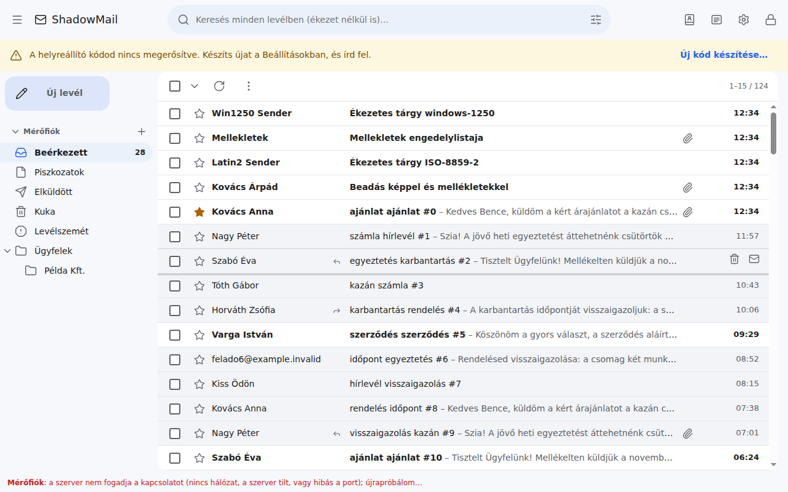
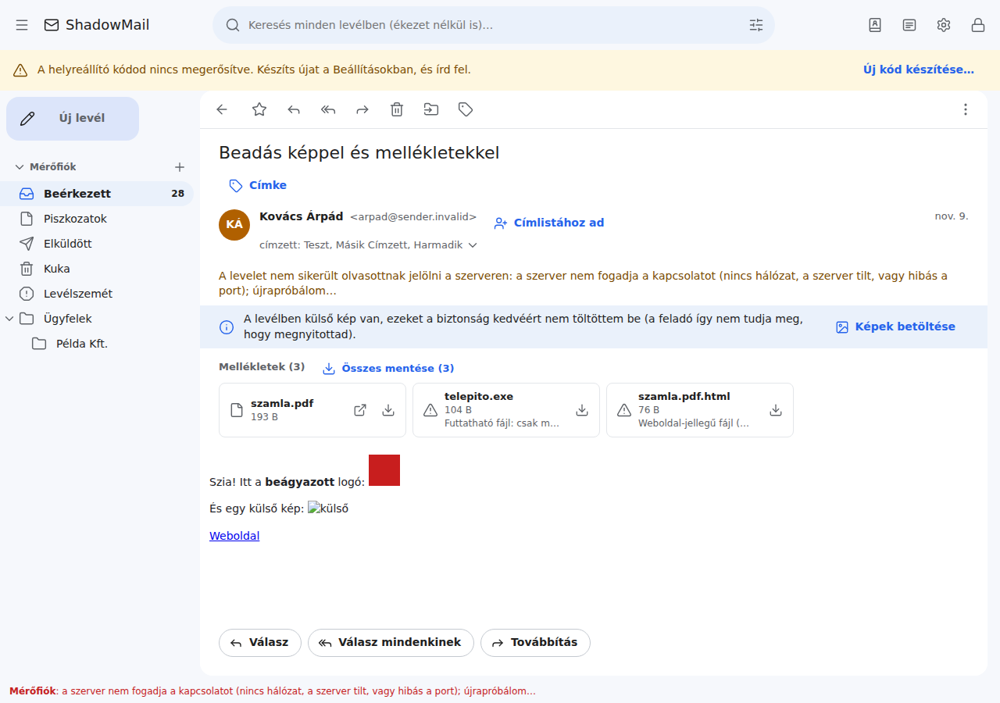
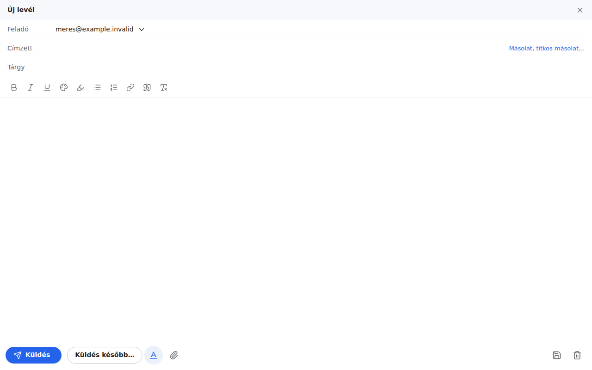
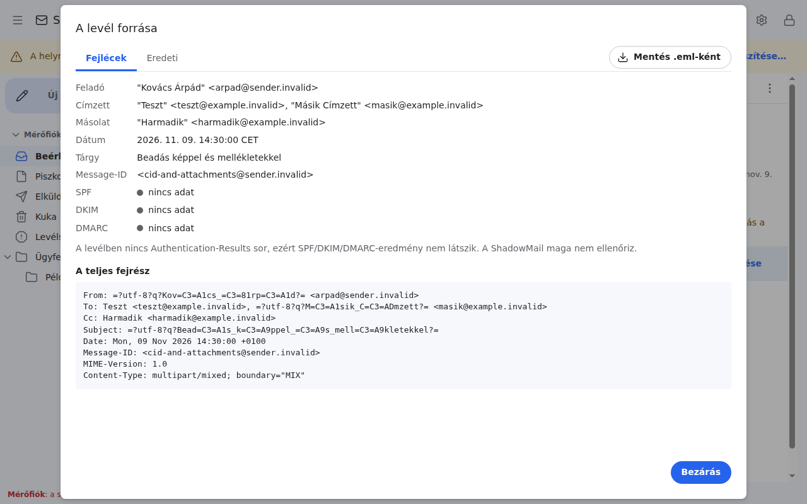
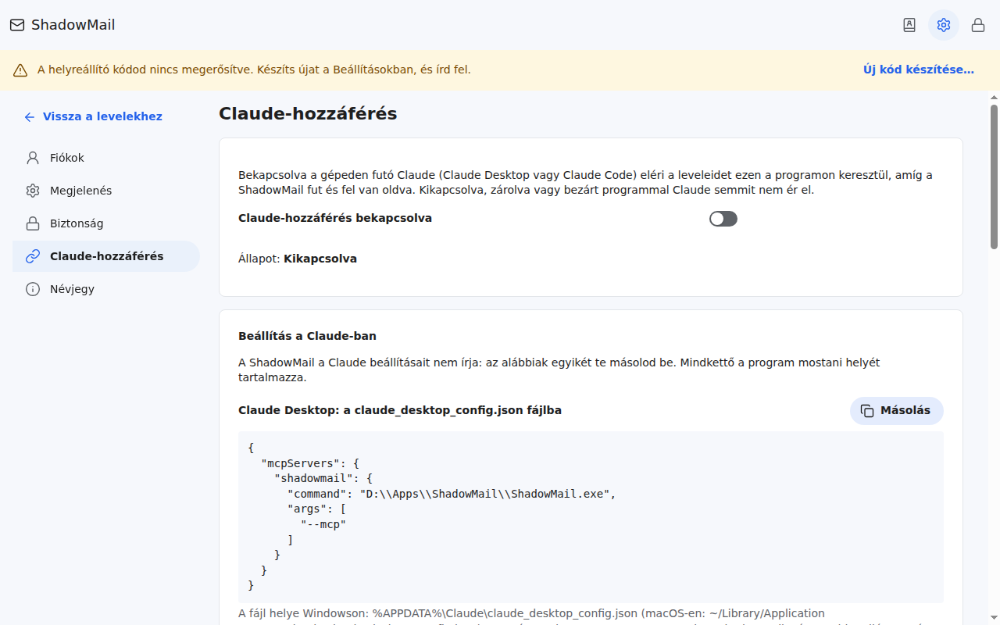

# ShadowMail

[English version](README.md)

Hordozható levelezőprogram Windowsra. Nem kell telepíteni: egy mappába kicsomagolva fut, és **minden adatát
a program melletti `data` mappában tartja** (fiókok, letöltött levelek, keresőindex, beállítások). A gépen
máshová (AppData, Temp, registry) nem ír. Két kivétel. Ha a program pendrive-ról (FAT/exFAT) fut, egy
melléklet **Megnyitás**-a a Windows ideiglenes mappájába (`%TEMP%\ShadowMail\…`) kerül, mert csak ott
jelölhető internetről származónak (lásd Biztonság röviden); a program induláskor és kilépéskor kiüríti. És a
Windows saját **Megnyitás/Mentés** ablaka megjegyzi a felhasználói registryben, melyik mappát használtad benne
utoljára (`HKCU\…\Explorer\ComDlg32\LastVisitedPidlMRU`, egy bejegyzés a `ShadowMail.exe` nevével): ezt a
Windows írja, nem a program. A Windows „Legutóbbi fájlok” listájába a ShadowMail nem tesz bejegyzést.



(A képek tesztadattal készültek: `node scripts/ui-screenshots.mjs readme --set readme --out docs/screenshots`.)

## Funkciók

- IMAP- és POP3-fiókok, több fiók egy programban.
- Levelek olvasása: biztonságos HTML-megjelenítés, a külső képek csak kérésre, mellékletek. Két vagy több mellékletnél
  az **Összes mentése** egy választott mappába menti mindet (a meglévő fájlt soha nem írja felül: "név (2).ext"; a
  levélbe ágyazott képek nem kerülnek bele), utána a **Megnyitás a mappában** mutatja őket. Ha a mentettek közt
  futtatható vagy weboldal-jellegű (HTML, SVG, XML) fájl is van, a program figyelmeztet.
- Keresés minden fiókban (ékezet nélkül is), szűrők a mappanézetben is.
- Levélírás és küldés (SMTP), válasz, továbbítás, mappakezelés.
- **Címlista**: névjegyek, vCard- és CSV-import és -export.
- A levél **fejléceinek és eredeti forrásának** megtekintése.
- **Claude-hozzáférés** (alapból kikapcsolva; lásd lent).
- **Magyar vagy angol** felület, öt **téma** (két sötét és két tömör, "klasszikus"), az olvasópanel jobbra, alul vagy
  sehol, egy gombbal váltható a fejlécben.
- **Kép a szöveges aláírás alatt**, fiókonként.
- A fiókok és a mappák **saját sorrendben** (húzással, menüből vagy billentyűvel); egy mappa **áthelyezhető** egy
  másik alá.
- A levél jelölőnégyzetén a **Shift** az utoljára jelölttől idáig az egész tartományt jelöli.
- **Címkék** a leveleken: több címke levelenként, saját színnel, szűrés címke szerint; IMAP-fióknál a szerveren.
- Windowson az olvasatlan levelek száma piros karikában a tálca-ikonon (minden fiók Beérkezett mappája együtt, 99 fölött "99+", zárolva nincs); kikapcsolható: Beállítások / Megjelenés.
- Minden adat titkosítva, mesterjelszóval (lásd Első indítás).





### Billentyűk megnyitott levélnél

- **Le** / **Fel**: a lista következő / előző levele (a lista mostani sorrendjében és szűrésével; keresésnél a
  találatok sorrendjében). A levél szövegét a **PageUp**, **PageDown** és a **Szóköz** görgeti.
- **Delete**: törlés, **End**: archiválás (a fiók Archívum-mappájába, évenkénti módban az év mappájába). Ha van
  látható kijelölés a listában, azokra hat, különben a megnyitott levélre. Az olvasó eszköztárában a Törlés mellett
  **Archiválás** gomb is van. Nyitott levél nélkül a Delete a látható kijelölést törli, az End a lista végére görget.
- Ha a levél a lista helyén van nyitva (olvasópanel nélkül), törlés, archiválás, áthelyezés (a Levélszemétbe is) vagy
  Olvasatlannak jelölés után azonnal **visszajön a lista**, ott, ahol hagytad. Ha az olvasó a lista mellett vagy alatt
  van, a lista **következő** (alatta lévő) levele nyílik meg; ha az volt az utolsó, az előző.
- Ahol nincs hova archiválni (a fióknak nincs Archívum-mappája, vagy a levél már ott van), az End nem csinál semmit,
  csak egy sor mondja meg, miért.
- A billentyűk akkor is működnek, ha a levél szövegébe kattintottál. Szövegmezőben, menüben, párbeszédablakban és a
  panelek elválasztóján a megszokott jelentésük marad.

### Billentyűk levélírásnál

- A **Ctrl+Enter** elküldi a levelet (mint a **Küldés**). Válasznál és továbbításnál a **Küldés és archiválás** gomb
  (és a **Ctrl+Shift+Enter**) a sikeres küldés után az eredeti levelet az Archívumba teszi; a gomb csak akkor látszik,
  ha a fióknak van Archívuma, és az eredeti még nincs benne. Ha egy címzettet a szerver elutasít, az eredeti a helyén
  marad. Nyitott párbeszédablak alatt egyik billentyű sem küld.
- A **Tab** a Tárgyból közvetlenül a levél szövegére lép (a formázási gombokat kihagyja), a **Shift+Tab** a
  szövegből vissza a Tárgyra.
- A formázási eszköztár a szövegből az **Alt+F10**-zel érhető el: a nyilak, a **Home** és az **End** lépked a gombok
  között, az **Enter** formáz, az **Esc** visszavisz a szövegbe (a kijelölés megmarad). A **Ctrl+B**, **Ctrl+I**,
  **Ctrl+U** a szövegben is működik.
- A **Szövegszín** és a **Kiemelés** (az Aláhúzott után) menüt nyit: elöl **Automatikus** / **Nincs kiemelés**, utána
  hat-hat szín. Billentyűvel: **Alt+F10**, a nyilakkal a gombra, az **Enter**, a **Szóköz** vagy a **Le** nyitja a menüt,
  a nyilak választanak, az **Enter** kiszínezi a kijelölt szöveget (kijelölés nélkül a következő begépelt szöveget), az
  **Esc** visszavisz a szövegbe. Az írófelület minden témában világos, ahogy a címzett látja a levelet.
- **Beillesztés (Ctrl+V)** böngészőből, Wordből, Excelből vagy a levélíróból: a formázás megmarad (táblázat rácsosan, szín,
  kiemelés, betűtípus és -méret, listák, címsorok), és így is megy ki; csak az esik ki, ami hibát okozhat (kód, külső
  kép, a levelet eltakaró vagy levágó elhelyezés, a rejtett szöveg, a háttere nélkül olvashatatlan szövegszín); a
  beillesztett rész saját stíluslapjának szabályai is megmaradnak (a Word Normál stílusa és címsorai, az Excel cellakeretei és
  kitöltése). A Wordből jövő felsorolás és számozás valódi lista lesz, a szintjeivel. Egy
  nagyon nagy (20 000 cellánál több) vagy mélyen egymásba ágyazott táblázat soronként jön; egy túl összetett rész
  formázás nélkül, egy sor jelzi. Ugyanez történik a szövegre húzott weboldal-részlettel.
- **Ctrl+Shift+V:** beillesztés formázás nélkül (csak a szöveg).
- **Válasz és továbbítás:** az idézet megtartja az eredeti levél formázását (táblázat rácsosan, kerettel és
  háttérrel, szín, betűtípus és -méret, a levél saját stíluslapjának szabályai is), ugyanazzal a szűréssel, mint a
  beillesztés: a rejtett szöveg (a háttérrel egyező színű is) kiesik, a sötét hátterű levél szövege az alap színnel
  olvasható. A nagyon nagy vagy mélyen egymásba ágyazott táblázat soronként jön, a túl összetett levél idézete
  formázás nélkül. Claude ugyanezt az idézetet kapja.
- Képet a vágólapról (**Ctrl+V**) vagy fájlként a szövegre húzva lehet a levélbe tenni (PNG, JPEG; más képformátum
  mellékletként csatolódik). A kép mérete a képen jobb gombbal, vagy a kép mellett álló kurzornál a **Shift+F10**-zel
  állítható: Kicsi (320 px), Közepes (640 px), Nagy (800 px), Eredeti méret, vagy a kép eltávolítása. Csak a megjelenített
  szélesség változik, a kép maga nem, és nagyobbra nem nyújtható; a **Ctrl+Z** visszavonja. Méret nélkül a 800 px-nél
  szélesebb kép 800 px széles lesz a levélben.

### Szűrők

A kereső melletti **Szűrők** gomb nyitja a szűrősort. Keresőszó nélkül a megnyitott mappa listáját szűri:
**Olvasatlan**, **Van melléklet**, **Csillagos**, **Bármikor** (dátumtól, dátumig). A számláló ilyenkor
így mutatja: "1–12 / 28 (szűrve, összesen 124)". Keresőszóval ugyanezek a találatokat szűrik.

- A szűrő **másik mappára váltva is megmarad**, és amíg él, a szűrősor látszik. Mindet a **Szűrők
  törlése** gomb kapcsolja ki (a lista fejlécében, és üres szűrt listánál alatta). Az Esc a keresőmezőben
  csak a keresést hagyja el, a szűrőket nem.
- A "mindet kijelöl" és a Ctrl+A **csak a szűrt leveleket** jelöli ki, a törlés is csak azokra hat.
- Az Olvasatlan szűrőben megnyitott levél olvasott lesz, de a listában marad, amíg szűrőt, mappát vagy
  rendezést nem váltasz, vagy nem nyomod meg a **Frissítés**t.
- A **Fiók** chip a választott fiók Beérkezett mappáját nyitja meg, a **Mappa** chip a választott mappát;
  a **Rendezés** chip ugyanaz, mint a lista **További** menüjének rendezése.
- Keresésnél a találatok alapból **dátum szerint** jönnek, a legújabb elöl. A **Rendezés** chipen a **Relevancia**
  választható, és a program megjegyzi: a következő kereséseknél (újraindítás után is) az marad, amíg vissza nem váltasz.

### Címlista

A fejléc **Címlista** gombja (a Beállítások mellett) nyitja a névjegyeket; újra megnyomva vissza a levelekhez.

- **Kik kerülnek be maguktól:** akinek levelet küldesz (Címzett, Másolat, Titkos másolat), az **Automatikus**
  névjegyként bekerül. A kapott levelek feladói maguktól nem kerülnek be: egy megnyitott levélnél a feladó neve
  mellett a **Címlistához ad** gombbal veheted fel (a saját címednél ez nem jelenik meg).
- **Névjegy:** megjelenített név, utónév, vezetéknév, cég, beosztás, megjegyzés, több e-mail cím (egy elsődleges)
  és több telefonszám. **Új névjegy**, **Szerkesztés**, **Törlés**; a **Levél írása** az elsődleges címre nyit
  levelet. Egy cím csak egy névjegyhez tartozhat.
- **Törlés:** a törölt névjegy címe a következő küldéskor **nem kerül vissza** magától (kézzel újra felveheted).
  A címkiegészítés sem ajánlja, amíg vissza nem veszed.
- **Importálás…:** vCard (`.vcf`, 2.1, 3.0, 4.0) vagy CSV (a Google és az Outlook oszlopaival, magyar Outlookét
  is), legfeljebb 10 MB és 10 000 névjegy. Előbb **előnézet** jön: hány új, hány összevont (ugyanaz a cím egy
  meglévő névjegynél: a meglévő adatok maradnak, csak az üres mezők töltődnek), hány változatlan és hány hibás
  sor; a figyelmeztetések (például 20-nál több cím egy névjegyben) külön. Csak a jóváhagyás után ír, egyetlen
  lépésben. A fényképek és a webcímek nem kerülnek be; a többi, itt nem szerkeszthető vCard-adat megmarad, és
  exportkor visszamegy.
- **Exportálás:** az összes vagy a kijelölt névjegyek vCard (3.0) vagy CSV (Google-formátum) fájlba. A CSV-ben a
  képletként értelmezhető cellák (`=`, `+`, `-`, `@` kezdet) egy `'` jelet kapnak, hogy egy táblázatkezelő ne
  futtassa őket; a `+36…` alakú telefonszám kivétel.
- Hálózat nincs: az import és az export csak helyi fájllal dolgozik. A címlista a titkosított adatbázisban van.


### Fejlécek és a levél forrása

Egy megnyitott levél **További** menüjében:

- **Fejlécek:** összefoglaló (Feladó, Címzett, Másolat, Dátum, Tárgy, Message-ID) és a fogadó szerver
  ellenőrzésének eredménye (**SPF**, **DKIM**, **DMARC**: zöld, ha megfelelt, piros, ha nem, szürke minden
  más esetben), alatta a nyers fejlécek. Az eredményt a program **nem maga ellenőrzi**: a legfelső
  `Authentication-Results` sorból olvassa, amit a levelet fogadó szerver írt; ezért csak tájékoztató.
- **Eredeti megjelenítése:** a levél teljes forrása szövegként (kb. 2 millió karakterig; a nagyobbnak a vége nem
  látszik, de mentéskor a teljes levél megy). A láthatatlan és vezérlőkarakterek jelölve (`⟨U+202E⟩` alakban), a
  levél HTML-je és képei itt soha nem jelennek meg.
- **Mentés .eml-ként:** a teljes, eredeti levél fájlba (a fájlnév a tárgyból); a mentett fájlt a program
  internetről származónak jelöli (lásd Biztonság röviden).



### Levél kihúzása más programba

- Egy levelet (vagy a kijelölt leveleket) a listából egérrel **más programba húzhatsz**: a Claude asztali appba, az
  Intézőbe, az Asztalra, egy másik levelezőbe. A levél ott `.eml` fájlként érkezik (a neve a tárgyból), a teljes,
  eredeti forrásával, mellékletekkel együtt, mint a **Mentés .eml-ként** fájlja.
- Ugyanez a mozdulat a program **saját mappájára** ejtve továbbra is áthelyezés.
- A fájl egy titkosítatlan másolat a `data\tmp` mappában (ahol az nem tudja megjelölni: a gép ideiglenes mappájában,
  `%TEMP%\ShadowMail`), internetről származónak jelölve. A program **10 perccel a húzás után** törli, és zároláskor,
  kilépéskor, induláskor is.
- Egy még le nem töltött levél (IMAP, soha nem nyitottad meg) első húzásra nem megy ki: a húzás a régi marad (mappára
  áthelyez, letöltés nélkül). Ha nem mappára ejtetted, egy sor szól, és a program a háttérben letölti (az olvasottságán
  nem változtat); egy pillanat múlva a második húzás már kiviszi.
- Egyszerre legfeljebb 50 levél és együtt 100 MB húzható ki; több vagy nagyobb kijelölés mappára így is áthelyezhető.

### Megjelenés

A **Beállítások / Megjelenés** alatt:

- **Nyelv / Language**: Magyar vagy English, azonnal érvényes. Választás nélkül a program magyar, a Windows nyelvétől
  függetlenül. A Claude-nak menő szövegek (Claude-hozzáférés) magyarok maradnak.
  A nyitott levélíró ablakok előbb elmentik a piszkozatukat és bezárulnak (amelyiknek a mentése nem sikerül, nyitva
  marad), utána a főablak az új nyelven töltődik újra.
- **Téma**: Alap (világos), Sötét, Grafit, Klasszikus kék, Klasszikus világos. A két klasszikus témában kisebbek a
  sorok és a gombok; a választásuk egyszer az olvasópanelt is beállítja (Klasszikus kék: jobbra, Klasszikus világos:
  alul). A levél saját HTML-je minden témában fehér háttéren látszik.
- **Olvasópanel**: jobbra a lista mellett, alul a lista alatt, vagy nincs (a levél a lista helyén nyílik). A
  fejléc **elrendezés-gombja** sorban váltja a hármat.
- **Olvasatlan levelek száma a tálca-ikonon** (Windows): alapból bekapcsolva.

### Képes aláírás

A **Beállítások / Fiókok** alatt, egy mentett fióknál: a **Kép feltöltése…** egy PNG- vagy JPG-képet tesz a szöveges
aláírás alá (legfeljebb 800 x 400 képpont és 150 KB; a program nem méretezi át). A kép metaadatait (például a
GPS-helyet vagy a szerzőt) mentéskor eltávolítja; az elforgatás-jelzős képet nem fogadja el (mentsd el elforgatva,
és töltsd fel újra). Új levélben a kép az aláírás szövege alatt látszik, és a levélben megy ki (nem webcímre mutató
hivatkozásként). A Feladó-fiók váltása csak az aláírás blokkját cseréli, a begépelt szöveg marad.

### A fiókok és a mappák sorrendje

- Egy mappát a testvérei (az azonos szülőjű mappák) közé húzhatsz: egy testvér felső vagy alsó szélére ejtve csak a
  sorrend változik. Egy fiók fejlécét a többi fiók közé húzva a fiókok sorrendje változik. Egy mappát egy másik mappa
  közepére ejtve oda kerül (lásd: Mappa áthelyezése).
- Ugyanez a jobb gombos menüből (**Feljebb**, **Lejjebb**), vagy **Alt+Fel** / **Alt+Le** billentyűvel a
  billentyűfókuszban lévő mappán vagy fiókfejlécen.
- A fiók jobb gombos menüjének **Mappák betűrendbe** pontja visszaadja a mappái eredeti sorrendjét.
- A sorrendet csak a ShadowMail tartja: a szerveren és más levelezőprogramokban nem változik semmi. Az átnevezett
  mappa a helyén marad, az új mappa a listája végére kerül.

### Mappa áthelyezése

- Egy mappát ugyanannak a fióknak egy másik mappájára (a sora közepére) húzva az alá kerül, az almappáival és a
  leveleivel együtt. A fiók fejlécére ejtve a legfelső szintre kerül. A program előtte mindig rákérdez.
- Ugyanez egér nélkül: a mappa jobb gombos menüjének **Áthelyezés…** pontja (vagy a mappán a **Shift+F10**) felsorolja,
  hová kerülhet; a nyilak, a **Home** és az **End** választ, az **Enter** áthelyez, az **Esc** elvet.
- Nem mozdul a Beérkezett, Piszkozatok, Elküldött, Kuka, Levélszemét vagy Archívum mappa, sem az, amelyik alatt ilyen
  van; mappa nem kerülhet a saját almappájába, a Kuka vagy a Levélszemét alá, sem másik fiókba. A lista megmondja,
  miért nem.
- IMAP-fióknál a szerver egy lépésben helyezi át a mappát: a levelek nem töltődnek le újra, és a feliratkozott mappák
  az új nevükön is feliratkozottak maradnak. POP3-fióknál ezen a gépen mozdul.

### Levelek kijelölése

- A levél jelölőnégyzetére **Shift**-tel kattintva az utoljára kattintott jelölőnégyzetig minden levél ugyanazt az
  állapotot kapja (jelöli vagy leveszi a tartományt); a kijelölés többi része marad.
- A soron a **Shift+kattintás** az utoljára kattintott sortól idáig jelöl ki, a **Ctrl+Shift+kattintás** hozzáadja a
  kijelöléshez.
- A tartomány a lista sorrendjét és szűrőjét követi, a még be nem töltött sorokra is; új rendezés vagy szűrő után a
  következő jelölőnégyzettől kezdődik újra.

### Címkék

A levelekre saját címkéket tehetsz (név és szín): a listában, a jobb gombos menüből, a kijelöltek eszköztárából vagy
az olvasóból. A **Címke** szűrő-chip szerint szűrhetsz; a Beállítások / Címkék alatt hozhatsz létre, nevezhetsz át,
színezhetsz, rendezhetsz és törölhetsz címkét.

- **IMAP-fióknál a címke a szerveren van**, a levélen kulcsszóként (a név kódolva, például `sz=c3=a1mla`). Más program
  (egy másik gép ShadowMailje, egy másik levelező) is láthatja és állíthatja; amit ott tesz fel vagy vesz le, az a
  következő szinkronnal ide is megérkezik: a Beérkezett mappában azonnal, más mappában a szinkron ütemével.
- **A címke a levél ezen példányáé:** ha ugyanaz a levél két mappában is megvan, a másik mappabeli példány nem kapja
  meg.
- **A név, a szín és a sorrend ezen a gépen** van. Új adatmappában (vagy másik gépen) a szerveren lévő címkéket akkor
  látod, ha ugyanazzal a névvel újra létrehozod a címkét. Más programok saját kulcsszavai nem válnak címkévé, és a
  címke-műveletek nem bántják őket.
- **Ha a szerver egy mappában nem enged egyéni kulcsszót,** a címke abban a mappában csak ezen a gépen tárolódik; ezt
  a program egy sorban jelzi. A Fiók szerkesztése / **Kapcsolat próbája** megmondja, enged-e a szerver.
- **Kapcsolat nélkül** (nincs hálózat, a fiók leállt) a címke nem változik, és hibasor mondja meg, melyik fióknál; a
  többi fiók levelei közben megkapják.
- **Törlés:** a címke a szerverről is lekerül azokról a levelekről, amelyeket a program már szinkronizált (egy még
  nem szinkronizált vagy nem mutatott mappa leveleiről nem). Ha egy fiók épp nem érhető el, a címke megmarad, a többi
  fióknál már lekerült, és a törlés újra megpróbálható.
- **Piszkozat:** az újra mentett piszkozat megtartja a címkéjét; az elküldött levél (az Elküldött mappabeli példány)
  nem kapja meg.
- **A korábban csak helyben tárolt címkék** (egy 0.17.0 előtti fejlesztői adatmappából) az első szinkron után
  feltöltődnek a szerverre, a levél minden példányára.
- **POP3-fióknál** a címke ezen a gépen tárolódik, és a levél minden helyi példányán látszik. Ha a levélnek nincs
  Message-ID és Date fejléce, egy újra letöltött példányán a címke nem látszik.
- Claude (MCP) felteheti és leveheti a meglévő címkéket; létrehozni, átnevezni és törölni csak te tudsz.

### Újdonságok a 0.22.0-ban, ismert korlátok

- **Küldés és archiválás:** válasznál és továbbításnál a **Küldés és archiválás** gomb (és a **Ctrl+Shift+Enter**)
  a sikeres küldés után az eredeti levelet az Archívumba teszi; a gomb csak akkor látszik, ha a fióknak van
  Archívuma, és az eredeti még nincs benne. A **Ctrl+Enter** elküldi a levelet (mint a **Küldés**). Ha egy
  címzettet a szerver elutasít, az eredeti a helyén marad.
- **Jobb klikk a levélben:** a megnyitott levélben a jobb gomb (és a Shift+F10) menüt nyit: linken **Link
  másolása** és **Megnyitás böngészőben**, e-mail címen **E-mail cím másolása** és **Új levél ide**, kijelölt
  szövegen **Másolás**, máshol **Az összes kijelölése**. A Link másolása a link VALÓDI célcímét másolja, akkor is,
  ha a link szövege mást mutat.
- **Linkek a sima szöveges levélben:** a csak szöveges levél webcímei (`https://...`, `www....`) és e-mail címei
  kattinthatók: a webcím a böngészőben, az e-mail cím a levélíróban nyílik; a látható szöveg nem változik.
- **Szinkron akadás nélkül:** a nagy postafiókok letöltése (több tízezer levél, több fiók egyszerre) alatt az
  ablak nem áll meg: a program kis darabokban ír, a fiókok levéltörzseit egymás után dolgozza fel, és a sok levelet
  tartalmazó mappák jelzőit (olvasott, csillag) darabokban kérdezi le. Kilépéskor a `data` mappában nem marad
  `-wal` és `-shm` fájl.
- **Szinkron-napló:** a `main.log` szinkronizálásonként egy sort kap számokkal (lásd lent: Hibakereséshez); levél-
  tartalom, mappanév, cím, szerver és felhasználó nincs benne.
- **A válaszolt / továbbított jel a feladó után:** a jel a listasorban és a keresési találatban a feladó (az
  Elküldött mappában a címzett) neve után, a cella jobb szélén áll, így a címkék és a tárgyak minden sorban egy
  vonalban kezdődnek. Ha egy levélre válaszoltál ÉS továbbítottad is, egy ikon látszik, rámutatva mindkettőt mondja.

A kiadás ismert korlátai:

- Windowson a fentieket nem mértük, csak Linuxon; a Windows-próba a kiadás előtt történik.
- Új levélről Windows-értesítés még nincs.
- A fiókok levéltörzsei egymás után töltődnek le: ha egy fióknak lassú a szervere, a többi fiók új levele a
  listában azonnal megjelenik, de a szövege (előnézet, keresés) egy adagnyi (legfeljebb 500 levél) letöltésig
  várhat rá.
- A sima szöveges levél linkjei a válasz-idézetben és a Forrás nézetben nem kattinthatók.

### Újdonságok a 0.21.0-ban, ismert korlátok

- **Az olvasatlan levél kiemelve:** a levéllistában és a keresési találatok közt az olvasatlan levél sora világosabb
  háttéren, vastag betűvel áll, az olvasotté halványan szürkés; a kijelölt sor erősebb kékes színt kap. Mind az öt
  témában.
- **Válaszolt / továbbított jel:** ha egy levélre válaszoltál vagy továbbítottad, a listasorban és a keresési
  találatban egy kis ikon jelzi (rámutatva: **Megválaszolva**, **Továbbítva**).
- **„Válaszoltál” sor az olvasóban:** a megnyitott levél fejlécében **Válaszoltál:** és a válaszod dátuma áll;
  a dátumra kattintva a válaszod nyílik meg (az Elküldött mappából). Több válasznál a darabszám és a legutóbbi
  dátuma, továbbításnál **Továbbítottad**. Ha a válaszod már nincs az Elküldött mappában: **Megválaszoltad**.
- **A piszkozatból küldött válasz is jelöl:** ha egy elmentett válasz- vagy továbbítás-piszkozatot később nyitsz
  meg és küldesz el, az eredeti levél is megkapja a válaszolt / továbbított jelet (eddig csak az azonnal küldött
  kapta). A más programban írt piszkozatokra ez nem vonatkozik.
- **Claude-kapcsolat javítás („két kapcsolat már él”):** ha a Claude Desktopban több beszélgetés volt nyitva, a
  harmadik nem tudott a ShadowMailhez csatlakozni, amíg az egészet újra nem indítottad. Most az új beszélgetés
  átveszi a legrégebben nem használt beszélgetés helyét, és az a következő kérdésénél magától visszacsatlakozik.
  Hibát csak akkor kapsz, ha két beszélgetés épp dolgozik a ShadowMaillel.
- **Beágyazott kép mellékletként:** ha egy levél egy képre csak a szövegében, egy megjegyzésben vagy egy
  attribútumban hivatkozik (a levélben nem látszik), vagy SVG-képet ágyaz be, a kép most mellékletként jelenik
  meg, és az **Összes mentése** is menti; eddig sehol nem látszott.
- **Lista egy bekezdésben:** ha a levélíróban egy meglévő bekezdésben kérsz felsorolást vagy számozást, a lista
  tisztán a bekezdés helyére kerül; eddig a küldött levél szöveges részében a lista előtt és után két-két üres sor
  jelent meg.
- **A lista eszközsora kijelölés közben:** osztott nézetben, keskeny listán a „N kijelölve” felirat és a
  levélszám nem csúszik egymásra, és a gombok is elférnek.

A kiadás ismert korlátai:

- Windowson a fentieket nem mértük, csak Linuxon; a Windows-próba a kiadás előtt történik.
- A piszkozatból küldött válasz jelölését IMAP-fiókon a felületen nem próbáltuk ki (a program saját tesztjei
  mérik).
- A Claude-kapcsolat javítását valódi Claude Desktoppal nem mértük, csak a program saját kapcsolódójával.
- Szándékos: egy 100 000 leveles mappában a feladó vagy tárgy szerinti rendezés szűrővel 0,2-0,4 másodperc; egy
  gyorsító index a teljes szinkront kb. 13%-kal lassítaná.

### Újdonságok a 0.20.0-ban, ismert korlátok

- **Claude mellékletet csatolhat a piszkozathoz:** egy fájlt a gépedről vagy egy meglévő levél mellékletét, új
  piszkozathoz, válasz-piszkozathoz vagy egy piszkozat módosításakor. Ez **mindig kérdez**, a Megerősítések
  kapcsolóitól függetlenül: az ablak minden fájl teljes útját vagy forrás-levelét, méretét és ujjlenyomatát mutatja,
  elutasításnál semmi nem íródik. Legfeljebb 50 fájl, a piszkozatban már lévőkkel együtt 25 MB; a fájl a kérés
  pillanatában olvasódik be.
- **Melléklettel menő küldés mindig kérdez:** ha Claude mellékletes levelet küldene (továbbítás az eredeti
  mellékleteivel, egy mellékletes piszkozat elküldése, időzítve is), a megerősítő ablak akkor is megjön, ha a küldés
  megerősítését kikapcsoltad. A beillesztett kép és az aláírás képe nem számít mellékletnek.
- **Claude a piszkozat képeivel küld:** ha Claude egy piszkozatot elküld, a beillesztett kép és az aláírás képe is
  kimegy (eddig kimaradt, az időzített küldésnél is). A megerősítő ablak kiírja a beágyazott képek számát és méretét.
- **Claude formázott szöveget írhat:** a piszkozatba, a válaszba és a küldött levélbe félkövér, dőlt, aláhúzott és
  áthúzott szöveget, listát, címsort, idézetet, kódot és linket (http, https, mailto). Minden mást (stílus, szín,
  kép, script, más hivatkozás, rejtett szöveg) a program ugyanúgy kiszűr, mint a levélírójában. Ha semmi látható nem
  marad, vagy a szöveg túl összetett, Claude hibát kap, és semmi nem íródik és nem megy ki.
- **A keresés alapból dátum szerint jön, a legújabb elöl;** ha a **Rendezés** chipen a **Relevanciát** választod, a
  program megjegyzi. A dátum szerinti szöveges keresés nagy postafiókban gyorsabb.
- **Gyorsabb szűrt lista és címkeválasztó:** a csillag-, olvasatlan- és címkeszűrő első oldala hamarabb jelenik meg
  (a darabszám egy pillanattal később jön, addig „…” áll a helyén), és egy egész mappa kijelölésekor a címkeválasztó
  is gyorsabban nyílik.
- **Stíluslapos hírlevél idézete és beillesztése formázva:** a 0.19.0 ismert korlátja (a nagy, saját stíluslapos
  hírlevél idézete formázás nélkül jött) a hírlevelek szokásos felépítésénél megszűnt.
- **Beágyazott kép mellékletként:** ha egy levél egy beágyazott képre csak háttérként, linkként vagy a szövegében
  hivatkozik (az olvasó ilyenkor nem mutatja), a kép most mellékletként jelenik meg, és az **Összes mentése** is
  menti; eddig sehol nem látszott.
- **Levélíró:** ha a szöveget kijelölve törlöd, és utána Enterrel, holt billentyűs vagy beviteli módszeres (IME)
  betűvel vagy beillesztéssel folytatod, a szöveg tisztán indul (nem örökli a törölt rész formázását és beillesztett
  stílusát), ugyanúgy, mint gépelésnél.
- **Biztonsági javítás a rejtett szöveg szűrésében:** ha egy stílusszabály ugyanazt rövid és hosszú alakban is
  megadta (például `margin: 0; margin-left: -2000px`, vagy `background` után fehér `background-color` fehér
  szöveggel), a szűrő eddig a rövid alakot vette, így az így elrejtett szöveg eljuthatott Claude-hoz és a
  keresőindexbe. Most a később írt nyer, mint a böngészőben; a beillesztés is így dönt.

A kiadás ismert korlátai:

- Ha a levél aláírása megmaradt, és a fölötte álló (beillesztett, saját stílusú) szöveget kijelölve törlöd, a
  következő szöveg megkaphatja a törölt blokk stílusát (betűméret, szín, háttér), és így is megy ki.
- Ha a küldés megerősítése ki van kapcsolva, és Claude mellékletes levelet küldene, a megerősítő ablak megjön, de
  nem írja ki, hogy a melléklet miatt kérdez.
- A megerősítő ablak Claude formázott szövegét sima szövegként mutatja (a linkek valódi célját igen).
- Szándékos: szöveg nélküli keresésben (csak szűrőkkel) az azonos időpontú levelek közül a később felvett áll elöl.

### Újdonságok a 0.19.0-ban, ismert korlátok

- **Formázott beillesztés böngészőből, Wordből és Excelből:** a levélíróba beillesztett rész megtartja a formázását:
  táblázat rácsosan, kerettel és kitöltéssel, szín, kiemelés, betűtípus és -méret, felsorolás és számozás (a Wordből
  jövő lista valódi lista lesz, a szintjeivel), címsorok. A **Ctrl+Shift+V** formázás nélkül illeszt be. Részletek
  fent, a „Billentyűk levélírásnál” alatt.
- **A formázás így is megy ki:** az elküldött levél a levélíróban látott formázással megy; a szöveges részében a
  táblázat soronként áll, a cellák tabulátorral elválasztva.
- **Az idézet megtartja a formázást:** a válasz és a továbbítás idézetében az eredeti levél táblázata, színei, betűi
  és a saját stíluslapjának szabályai is megmaradnak, ugyanazzal a szűréssel, mint a beillesztésnél. Claude ugyanezt
  az idézetet kapja.
- **Levél kihúzása más programba:** a listából egy vagy több levél `.eml` fájlként húzható a Claude asztali appba,
  az Intézőbe, az Asztalra; a program saját mappájára ejtve továbbra is áthelyezés. Részletek fent, a „Levél kihúzása
  más programba” alatt.
- **Két biztonsági javítás a rejtett szöveg szűrésében:** a képernyőn kívülre tolt szöveget (negatív behúzás vagy
  margó, eltolás, transzformáció) a szűrő most bármilyen egységben felismeri (`em`, `%`, `vw`, `calc()`, kitevős
  vagy hosszú tizedes szám), és az ugyanígy megadott apró betűméretet is (például `font-size:1e-9px`). Az ilyen, a
  levélben nem látszó szöveg eddig eljuthatott Claude-hoz és a keresőindexbe.

A kiadás ismert korlátai:

- Egy nagy, saját stíluslapos hírlevél (több száz szabály, több száz blokk) idézete formázás nélkül jön, mint a túl
  összetett levélé: a program munka-korlátja előbb ér véget.
- A rejtett szöveg szűrője néha látható szöveget is rejtettnek vesz: a negatív margóval vagy behúzással kijjebb tolt
  szöveget akkor is, ha mellette nagy belső margó (padding) a helyén tartja. Az ilyen szöveg Claude-hoz, a
  keresőindexbe, az idézetbe és a beillesztésbe nem kerül át.
- Egy még le nem töltött levél (IMAP, soha nem nyitottad meg) első húzásra nem húzható ki, csak a második húzásra.
- Valódi Word- és Edge-vágólappal nem mértük: a Word-beillesztést mesterséges mintán, az Excelét egy valódi
  Excel-másolaton próbáltuk ki.

### Újdonságok a 0.18.0-ban, ismert korlátok

- **Az eredeti levél képei a válaszban és a továbbításban:** az eredeti szövegében látható képek (PNG és JPEG) az
  idézetben is megjelennek, méretezhetők és törölhetők, mint egy beillesztett kép, és a leveledben, a szövegben mennek
  ki. Továbbításkor ezek nem kerülnek még egyszer mellékletbe; minden más melléklet a régi módon jön.
- **A táblázat megtartja a sorait:** a weboldalról beillesztett táblázat, és a válasz vagy a továbbítás idézetében álló
  táblázat soronként egy sorban jelenik meg, a cellák egymás mellett, a fejléc-cellák félkövéren; az elküldött levél
  szöveges része is soronként. (A 0.19.0 óta az idézetben a táblázat rácsosan marad, lásd fent.)
- **A kézzel választott mappaszerep vándorol a mappával:** a fiókbeállításban kézzel kijelölt Archívum, Elküldött,
  Piszkozatok, Kuka vagy Levélszemét mappa átnevezhető, áthúzható és az **Áthelyezés…** paranccsal (billentyűvel is)
  áthelyezhető, és a fölötte álló mappa is; a szerep az új helyen marad. Az a szerep, amit a program maga talált (a
  Beérkezett, a szerver saját mappái, a szokásos nevek), és az ilyen mappára kézzel rögzített szerep a helyén marad.
- **Más írásmódú kép:** ha a levél szövege más kis-nagybetűvel vagy %-kódolva hivatkozik a képére, az olvasó most is
  megmutatja, és nem kínálja fel mellékletként.
- **Nagyon nagy kép** (50 megapixel fölött) nem kerül a szövegbe; egy sor jelzi, és mellékletként csatolható.
- **Vissza a listába:** ha a levél a lista helyén van nyitva, törlés, archiválás, áthelyezés vagy Olvasatlannak jelölés
  után azonnal visszajön a lista (ott, ahova görgetted); ha az olvasó a lista mellett vagy alatt van, a következő levél
  nyílik, mint eddig.
- **Szövegszín és kiemelés a levélíróban:** az eszköztáron az Aláhúzott után **Szövegszín** és **Kiemelés** gomb,
  mindkettőben **Automatikus** / **Nincs kiemelés** és 6-6 szín. Az írófelület minden témában világos, mint a levél
  lapja. A levélírón belül kimásolt vagy kivágott szöveg megtartja a színét, a máshonnan beillesztett szöveg színtelen;
  a mentett piszkozat színesen nyílik újra, a válasz és a továbbítás idézete színtelen (a 0.19.0 óta az eredeti
  színeivel).

A kiadás ismert korlátai:

- Az idézetbe csak a HTML saját képcímkéjével megjelenített kép kerül. A háttérként vagy stílusban használt kép
  válaszból kimarad, továbbításkor mellékletként jön, mint eddig.
- Egy nagyon nagy, egy sorban szóközzel tagolt cellájú táblázat válaszra már nem kérdez; a program lassítására
  épített táblázat továbbra is kérdez, most a túl sok, lassan megjeleníthető karakterről szóló szöveggel.
- Egy színes levél megnyitásakor az olvasó a fejlesztői konzolba egy biztonsági (CSP) figyelmeztető sort ír; a
  felületen ebből semmi nem látszik, és a levél rendben megjelenik.
- Két levélíró ablak között másolt szöveg a színét elveszti (egy ablakon belül megtartja).

### Újdonságok a 0.17.0-ban, ismert korlátok

- **Címkék:** egy levélre több címke tehető, mindegyik a saját színével (12 felkínált szín vagy egyéni). Feltehető a
  jobb gombos menü **Címkék…** pontjával, a kijelölés eszköztárának címke-ikonjával és az olvasóban; több kijelölt
  levélnél a választó mutatja, melyik címke van mindegyiken és melyik csak némelyiken, és begépelt névvel új címke is
  készíthető. A listában a tárgy előtt legfeljebb három címke látszik (keskeny listán színes pöttyök), a többit "+N"
  jelzi; az olvasóban mind, egy "x"-szel levehetők. A **Beállítások / Címkék** fülön: új címke, átnevezés, szín,
  sorrend, törlés. Részletek fent, a **Címkék** szakaszban.
- **IMAP-fióknál a címke a szerveren tárolódik** (kulcsszóként a levélen), így más gép vagy más levelező is láthatja;
  POP3-nál ezen a gépen. A **Kapcsolat próbája** megmondja, enged-e a szerver egyéni címkét, és hol tárolódnak a fiók
  címkéi.
- **Címke-szűrő:** a mappanézet és a keresés **Címke** chipjével egy címke leveleire szűkíthető; a menü **Mind**
  pontja kikapcsolja.
- **Claude és a címkék:** Claude látja a levelek címkéit, címke szerint listáz és keres, és a meglévő címkéket
  megerősítés nélkül felteheti és levehetheti; címkét létrehozni, átnevezni vagy törölni csak te tudsz.
- **Levélírás:** a Tárgy mezőből a Tab egyenesen a levél szövegére ugrik (a formázó sávra Alt+F10); a kitörölt
  szövegbe gépelve nem öröklődik a régi formázás, és a félkövér szöveg dőltre állítása is látszik.
- **Kép a levélben:** kép beilleszthető (**Ctrl+V**), vagy PNG / JPEG ejthető a szövegre; a levélben megy ki. Jobb
  gombbal a mérete állítható (320, 640, 800 px, eredeti), vagy eltávolítható. Az elforgatva készült fotót a program
  felállítja (az aláírás-képet is); a helyadat és a többi metaadat lekerül róla.
- **Mappa áthelyezése** egy másik alá: ráhúzva, vagy a menüjében az **Áthelyezés…** pont (lásd: Mappa áthelyezése).
- **Shift a jelölőnégyzeten:** levelek tartománya jelölhető (lásd: Levelek kijelölése).
- **Összes mentése:** két vagy több melléklet egyszerre egy mappába; ha futtatható vagy weboldal-jellegű (HTML, SVG,
  XML) fájl van köztük, a program figyelmeztet.
- A levélíró saját **Bezárás** gombja is rákérdez a mentetlen levélre, mint az ablak X-e.
- Windowson a keresőmező gombjai és az egysoros mezők szövege a középvonalon ül; az ablak széle közelében nyitott
  menü az ablakon belül marad.

A kiadás ismert korlátai:

- A felállított fotó színprofilja elvész (a színek a szabványos térben látszanak). Az 50 megapixelnél nagyobb
  elforgatott fotót a program nem veszi át; a forgatást nem igénylő képre nincs ilyen korlát (a 0.18.0 óta van: lásd ott).
- A címke neve, színe és sorrendje ezen a gépen van: új adatmappában vagy másik gépen a szerveren lévő címkét akkor
  látod, ha ugyanazzal a névvel újra létrehozod.
- IMAP-fióknál a címke a levél adott példányáé: a másik mappabeli másolat nem kapja meg. Más mappa változása (amit egy
  másik program tett fel vagy le) a szinkron ütemével jön, csak a Beérkezett azonnal.
- Kapcsolat nélkül a címke nem változik (hibasor mondja, melyik fióknál). Ha a piszkozatot másik fiókba mented
  (Feladó-váltás), a régi fiókbeli címkéi nem jönnek vele.
- Message-ID nélküli POP3-levélnél a címke a feladóhoz, a dátumhoz és a mérethez kötődik; ha a levélnek dátuma sincs,
  és a program egyszer újra letölti, az új példány nem kapja meg a régi címkéit.
- Egy 100 000 leveles mappában egy gyakori címke szűrt listájának első oldala kb. 0,25-0,5 másodperc, és egy egész
  mappa kijelölésekor a címkeválasztó kb. 0,65 másodperc alatt nyílik.
- Ha van címke, a mappanézet chipsora 1280 képpont széles ablakban két sorba törhet.

### Újdonságok a 0.16.0-ban, ismert korlátok

- **Küldés később:** a levélírás **Küldés később…** gombja (ma 18:00, holnap 8:00, hétfő 8:00 vagy egyéni időpont,
  a gép helyi idejében). Az időzített levél titkosítva, helyben vár, a piszkozata lekerül a Piszkozatokból, és CSAK
  akkor megy ki, ha a ShadowMail fut és fel van oldva. A bal sáv tetején az **Időzített (N)** lista minden fiók
  időzített leveleit mutatja: **Megnyitás** (levélíróban szerkeszthető), **Időpont módosítása**, **Küldés most**,
  **Időzítés törlése** (vissza a Piszkozatok közé). Átmeneti hiba után 1, 5 és 15 perc múlva újra próbál. Ha az
  időpontban a program egy napnál tovább nem futott (vagy a gép aludt), a levél **lekésett**: magától nem megy ki,
  te döntesz. Ha a küldés közben a program leállt (**megszakadt**), vagy a szerver a teljes levél átvétele után nem
  válaszolt (**bizonytalan**), a levél kimehetett, de ez nem biztos (Elküldött-másolat csak sikeres küldés után
  készül): magától soha nem küldi újra; a **Küldés most** és a levélíróban megnyitott levél küldése ilyenkor előbb
  rákérdez.
- **Mappatörlés a szerver levélszámával:** IMAP-fióknál a törlés figyelmeztetése a szerveren lévő levelek számát
  mondja (a válaszig "legalább N"); ha a szerver nem válaszol, a helyi szám marad, alsó korlátként.
- **Claude megerősítései műveletenként:** a Beállítások / Claude-hozzáférés / **Megerősítések** alatt műveletenként
  kikapcsolható a megerősítés. Kikapcsolt küldésnél Claude kérdés nélkül csak a névjegyzékben lévő címekre küldhet;
  ismeretlen, ékezetes vagy más nem angol betűs címnél az ablak megjön, és megnevezi a címet. Claude leveleinek
  címzettjei nem kerülnek a névjegyzékbe. A belépési adatok (szerver, port, titkosítás, felhasználónév,
  tanúsítvány-ellenőrzés) módosítása mindig kérdez. Egy leállt fiók belépését kikapcsolt megerősítésnél is csak
  egyszer indítja újra magától, utána újra kérdez, amíg te nem lépsz (Frissítés, a fiók mentése, Kapcsolat próbája).
- **Claude módosíthat egy piszkozatot** (címzettek, tárgy, a saját szövege): az aláírás, az idézet, a továbbított
  rész és a mellékletek maradnak, és semmi nem megy ki. Alapból megerősítés nélkül fut (a Megerősítések alatt
  bekapcsolható); a névjegyzékben nem szereplő új címzett felvétele mindig kérdez. Levélíró ablakban nyitott
  piszkozathoz nem nyúl.
- **Claude időzíthet:** a levél küldése és a piszkozat elküldése időponttal is kérhető, a megerősítő ablak kiírja az
  időpontot. Claude listázhatja az időzített leveleket, és visszavonhat egy időzítést (a levél visszakerül a
  Piszkozatok közé): a saját maga által időzítettet kérdés nélkül, a te saját időzítésedet csak a megerősítéseddel
  (ez nem kapcsolható ki; a te időzítésednek számít az is, amit Claude időzített, de te a levélíróban átírtál és
  elmentettél); minden visszavonásáról sáv jelenik meg. Az időpontot és a tartalmat nem módosíthatja.
- **Címzett az Elküldött és a Piszkozatok listájában:** ezekben a mappákban a feladó helyén az első címzett neve
  (név híján a címe) áll, több címzettnél "Név +2", az egérmutató alatt a teljes lista; ha csak titkos másolat (Bcc)
  van, az. A rendezés itt címzett szerint megy. A vesszőt vagy idézőjelet tartalmazó nevet a program mostantól idézve
  tárolja, így a lista egy címzettnek mutatja.
- **Ékezetes feladó és tárgy régi webes űrlapokról:** egyes régi űrlap-levelezők a feladót és a tárgyat kódolás
  nélkül, nyers bájtokkal küldik; ezek eddig hibás (�) betűkkel látszottak a listában, az olvasóban, a keresőben és a
  válasz idézetében. Most a levél saját karakterkészletével (ennek híján közép-európaival, windows-1250) olvassa; a
  már letöltött levelek sorai a következő szinkronkor javulnak.
- **Hová visz valójában egy link:** egy HTML-levél linkje fölött (vagy Tab-bal a linkre lépve) a levél bal alsó
  sarkában sáv mutatja a valódi célcímet; ha a link szövege más domaint mutat, a sáv piros figyelmeztetés. Részletek
  és korlátok: Biztonság röviden.
- **Hosszú sima szöveges levél:** a szöveg a saját dobozában görget, a Válasz gombsora nem takarja el.
- **Keresés terhelt gépen:** a nagy levelek keresőszövegét készítő lépés időkorlátja a saját processzoridejét méri,
  nem az eltelt időt, így terhelt gépen egy nagy levél szövege jóval ritkábban marad ki a keresőből (a 0.15.0
  ismert korlátja).
  Ha egy letöltött levél mégis túl összetett, egy későbbi, szabad pillanatban egyszer újra próbálja.

A kiadás ismert korlátai:

- Az újdonságokat Linuxon mértük; Windowson (a csomagon) még nem.
- A levelekbe rejtett utasítások (prompt-injekció) kezelését a programon át (e2e) csak POP3-fiókkal mértük,
  IMAP-fiókkal egységteszt méri.
- Ha zároláskor éppen megy egy időzített levél, a zárolás legfeljebb 10 másodpercet vár rá; ha a küldés tovább tart,
  a levél a következő feloldáskor megszakadtként jelenik meg.
- Claude mappatörlési kérésének megerősítő ablaka a helyi levélszámot mutatja, nem a szerverét.
- A 0.16.0 előtt tárolt Elküldött- és Piszkozat-sorokban a név idézetlen: egy vesszőt és címet is tartalmazó név
  ("a@pelda.example, Valódi <r@x>") a listán továbbra is hamis első címzettet adhat. Az olvasó mindig a valódi
  címzetteket mutatja.
- A nyers bájtos fejléc javítása a feladóra, a tárgyra és a címzettekre (To, Cc) vonatkozik; a titkos másolat (Bcc)
  és a mellékletek neve nem javul.
- A link-sáv figyelmeztetése elmarad, ha a link szövege több szó ("Belépés: bank.example") vagy rejtett; levélcím
  (mailto) linknél a sáv a másolat- és szöveg-részt (`?cc=`, `body`) nem mutatja.

### Újdonságok a 0.15.0-ban, ismert korlátok

- **Mappaszerepek kézzel:** a Beállítások / Fiókok / egy IMAP-fiók szerkesztőjében a Piszkozatok, az Elküldött, a
  Kuka, a Levélszemét és az Archívum mappa kiválasztható; az "Automatikus" a program saját döntése. A választás
  azonnal érvényes, a szerveren semmi nem változik.
- **Archiválás évenként:** ha az Archívum alatt évszámos almappák vannak (vagy a fiókban ez van beállítva), az
  Archiválás a levelet a saját évének mappájába teszi, a hiányzó év-mappát létrehozza.
- **Almappák csukása a bal sávban,** a csukott mappa száma az almappák olvasatlanjait is mutatja.
- **Mappák feliratkozása:** IMAP-fióknál csak a szerveren feliratkozott mappák látszanak; a fiók menüjében
  ("Mappák feliratkozása…") és a mappa menüjében (Leiratkozás) állítható. Frissítés után semmi nem tűnik el.
- **Billentyűk megnyitott levélnél:** Le/Fel a következő/előző levél, Delete törlés, End archiválás; törlés vagy
  archiválás után a következő levél nyílik.
- **Új fióknál a típust (IMAP vagy POP3) választani kell;** eddig is választható volt, csak előre ki volt jelölve
  az IMAP.
- **Egységes űrlapok:** a fiókszerkesztő, a Címlista, a Megjelenés és a Biztonság új elrendezést kapott (szakaszok,
  a tartalomhoz illő mezők, a Mentés gomb mindig látszik; a Címlistában a vezetéknév elöl, az elsődleges cím
  rádiógombbal).

A kiadás ismert korlátai:

- Ha egy évenkénti archiválásnál a második áthelyezés a szerveren elbukik, a lista csak a következő szinkronnál
  frissül; egy már létező év-mappánál a szerver "a mappa már létezik" hibát adhat.
- Nagyon terhelt gépen egy-egy nagy levél szövege nem kerül a keresőbe (a 0.12.0 óta így van).
- A fiókszerkesztő Archiválás-menüje a hosszú választást levágja; 860 px széles ablakban a Címlista
  szerkesztőjének címoszlopa keskeny.
- A Windows-csomagot (ZIP) a kiadás előtt Windowson ellenőrizzük; a valódi Windows-tálcát és a billentyűket egy
  megnyitott HTML-levél belsejében Linuxon nem mértük.

### Újdonságok a 0.14.1-ben, ismert korlátok

A 0.14.1 javító kiadás:

- **Mappaszerepek több program által használt postafiókon.** Ha a szerver nem jelöli, melyik mappa az Elküldött, a
  Lomtár, a Piszkozatok és a Levélszemét, a 0.14.0 a nevek közül ábécérendben az elsőt választotta. Így egy fiókban,
  ahol a "Sent" mellett egy másik program "Elküldött elemek" mappája is ott van, a gyári Elküldött a szinte üres
  mappára mutatott. Most a szerver saját jelzője dönt; ha nincs, a több levelet tartalmazó mappa nyer, és a
  választás megmarad. A javítás a frissítés utáni első teljes szinkronnal lép életbe.
- **Nagyobb szám a tálca-ikonon:** a számjegy a karika kb. fele, simított, élénkebb piros alapon.
- **Az új levél ablaka** a főablak monitorán, a főablak közepén nyílik (eddig mindig az elsődleges kijelzőn).

A kiadás ismert korlátai:

- A 0.14.0 küldés közben a levél másolatát, törléskor a levelet a rossz mappába (például "Elküldött elemek",
  "Törölt elemek") tette a szerveren. Ezek a levelek **ott maradnak**: a 0.14.1 a szerveren semmit nem mozgat, kézzel
  áthelyezhetők.
- A **valódi Windows-tálcát** és a **két monitoros** elrendezést a kiadás előtt nem mértük; csak a program által
  rajzolt képet és a hely számítását.
- 125%-os második kijelzőn az új levél ablaka néhány képponttal kilóghat a kijelzőről (az Electron kerekítése).

### Újdonságok a 0.14.0-ban, ismert korlátok

A 0.14.0 a 0.12.0 óta elkészült mindent hozza: az angol felületet, a témákat és az elrendezés-gombot, a képes
aláírást, a fiók- és mappasorrendet, az olvasatlanok számát a tálca-ikonon, a **Szerkesztés** gombot a Piszkozatok
mappa levelein, a szűken is olvasható levéllistát, a gyorsabb mappaszámokat a bal sávban, a nagyon nagy, táblázatos
leveleken a fagyás megszűnését, és a kérdést a válasz előtt, ha egy levél írásiránya nagyon sokszor vált (lásd
"Hibás vagy káros levélre írt válasz").

A kiadás ismert korlátai:

- A 0.14.0 Windows-csomagja a kiadás előtt **nem futott**: a tesztjei Linuxon futottak (a gazda döntése).
- A **tálca-karikát valódi Windows-tálcán** nem ellenőriztük; csak a program által rajzolt képet mértük.

## Letöltés és indítás

A legújabb változat: [github.com/arnyek/ShadowMail/releases/latest](https://github.com/arnyek/ShadowMail/releases/latest)
(az Assets alatt a `ShadowMail-<verzió>-win-x64.zip` fájl).

1. A `ShadowMail-<verzió>-win-x64.zip` fájlt csomagold ki egy **helyi** mappába, például
   `D:\Programok\ShadowMail` vagy egy pendrive-ra.
2. Indítsd el a `ShadowMail.exe`-t.

### Windows SmartScreen

A program nincs digitálisan aláírva, ezért az első indításkor a Windows figyelmeztethet
("A Windows megvédte a számítógépet"). Ilyenkor: **További információ**, majd **Futtatás mindenképp**.
Ezt csak egyszer kell megtenni.

## Első indítás: a mesterjelszó

Az első indításkor egy **mesterjelszót** kell megadnod (legalább 10 karakter, kétszer). Ez titkosítja a
`data` mappában a teljes levelezést: a fiókok jelszavait, az adatbázist (levéllista, keresőindex) és a
letöltött leveleket. Minden indításkor ezzel oldod fel a programot, bármelyik gépen.


### A helyreállító kód

A mesterjelszó után a program egy **helyreállító kódot** mutat (25 karakter, ötös csoportokban, például
`7K3QD-…`). Ezzel léphetsz be, ha elfelejted a mesterjelszót. **Írd le vagy mentsd el** (**Másolás**,
**Mentés fájlba**), és tartsd biztos helyen, a géptől és a pendrive-tól külön. Továbblépni csak akkor lehet,
ha a kód egyik csoportját visszaírod. Aki a kódot megszerzi, a mesterjelszó nélkül is kinyitja a
levelezésedet. A program a kódot nem tárolja; ha elveszik, a **Fiókok és beállítások** **Biztonság** fülén az
**Új kód készítése** gomb (a mesterjelszóval) újat készít, a régi érvényét veszti a jelenlegi
`vault.json`-nal. Ha a kód-képernyő megerősítés nélkül bezárul, a következő feloldás után egy sáv emlékeztet.

A **Másolás** után a kód 60 másodpercig marad a vágólapon: utána, zároláskor és kilépéskor a program
törli, de csak akkor, ha még pontosan a kód van rajta (amit közben máshonnan másoltál, ahhoz nem nyúl).
Windowson a kód a vágólap-előzményekbe (Win+V) és a felhős vágólapra sem kerül fel.

**A régi kód és a régi jelszó egy korábbi adatmappa-mentéssel együtt továbbra is kinyitja a levelezést.** A
kódcsere, a kóddal végzett helyreállítás és a jelszócsere csak a `data\vault.json` fájlt írja át, a levelek
kulcsa ugyanaz marad. Egy korábbi `vault.json`-másolat (például egy régebbi adatmappa-mentésben) ezért a régi
kóddal vagy a régi mesterjelszóval a mostani adatbázist és leveleket is nyitja. **Ha a kód vagy a jelszó
illetéktelen kézbe került, a régi mentéseket is semmisítsd meg.**


### Ha elfelejted a mesterjelszót

A feloldó képernyőn **Elfelejtettem a mesterjelszót**, két út:

- **Van helyreállító kódom**: a kód (kis- és nagybetű, szóköz, kötőjel mindegy; I és L = 1, O = 0) és egy új
  mesterjelszó kétszer. **Semmi nem vész el.** Utána új kódot kapsz, a használt érvényét veszti a jelenlegi
  `vault.json`-nal (egy régi mentéssel lásd fent).
- **Nincs kódom**: teljes újrakezdés. **Minden helyi adat elvész**: a fiókok és a jelszavaik, a
  keresőindex, a POP3-levelek, a helyi mappák, a csak helyben lévő piszkozatok és Elküldött-másolatok. Az
  IMAP-levelek a fiók újbóli felvétele után a szerverről újra letöltődnek. A megerősítéshez a `TÖRLÉS` szót
  kell beírni, utána új mesterjelszó kétszer. A régi adat a kulcsa nélkül olvashatatlan, ezért törölhető.

**Írd fel a mesterjelszót és a kódot is biztonságos helyre.**

### Félbeszakadt újrakezdés

Ha a **Nincs kódom** újrakezdés közben a gép leáll, a program a következő indításkor maga befejezi vagy
visszacsinálja. Ha nem tudja biztosan eldönteni, hol tartott, magától nem töröl semmit: a feloldó képernyő
ezt kiírja, és felkínálja az **Újrakezdés befejezése** gombot. Ez ugyanaz, mint a **Nincs kódom** út
(`TÖRLÉS`, új mesterjelszó kétszer): **minden helyi adat törlődik**, utána üres program és új kód jön. Ha
előtte bármit meg szeretnél tartani, a program bezárása után **másold le a teljes `data` mappát**.

A **Zárolás** gomb azonnal elfelejti a kulcsot: a nyitott levélírók előbb elmentik a piszkozatukat és
bezárulnak, a szinkron leáll, az adatbázis bezárul, amíg újra fel nem oldod.

## Fiók felvétele

**Fiókok és beállítások** → **Új fiók**. Kell hozzá: a szerver neve, portja, a biztonsági mód (SSL/TLS,
STARTTLS, vagy titkosítás nélkül), a felhasználónév és a jelszó, az SMTP (küldés) adatai. A
**Kapcsolat próbája** gomb ellenőrzi, mielőtt elmented.

- **Indexelt levelek** (a Szinkronizálás szakaszban, alapból 3 év): ennél régebbi leveleknek csak a fejléce (feladó, tárgy)
  kereshető helyben; a szövegükben a keresés "Keresés a szerveren is" (IMAP) vagy "Keresés a régi levelek
  szövegében is" (POP3) gombjával lehet keresni. Amit egyszer megnyitottál, az mindig kereshető marad.
- **A helyi keresés a levél LÁTHATÓ szövegében keres**: HTML-levélnél abban, amit az olvasó is mutat (a
  rejtett előnézeti szöveg, a fehér a fehéren, a `display:none` kimarad), csak-szöveges levélnél a szövegben. A lista
  előnézetében a rejtett előnézeti szöveg látszik. Egy túl összetett HTML-levélnek csak az első 128 KB-ja kereshető;
  ha az is túl összetett, csak a tárgya és a feladója. A "Keresés a szerveren is" a SZERVER keresése a teljes
  levélben: a rejtett szövegre is találhat.
- **POP3**: a levelek alapból a szerveren maradnak; a "Törlés a szerverről N nap után" beállítással a
  program a letöltés után N nappal törli őket a szerverről (a gépen megmaradnak).
  Egyes szerverek (pl. Dovecot) a POP3-letöltéskor a levelet a szerveren olvasottnak jelölik. Ha ugyanezt
  a postafiókot IMAP-on (webmail, telefon) is nézed, ott a letöltött levelek olvasottként látszanak.
- **Hibás jelszó**: ha a szerver elutasítja a belépést, a program az adott fiókkal **nem próbálkozik újra
  magától** (sok szerver néhány hibás próba után letiltja a gépet). Javítsd a jelszót a fiók
  beállításainál, vagy nyomd meg a **Frissítés** gombot.

## Adatmappa, mentés, frissítés

Minden adat a `ShadowMail.exe` melletti `data` mappában van. **Mentés: a program bezárása után másold le
az egész `data` mappát** (például egy másik meghajtóra). Visszaállítás: a mentett `data` mappát másold a
`ShadowMail.exe` mellé.

- `data\mail.sqlite`: fiókok (titkosított jelszavakkal), levelek adatai, keresőindex
- `data\store\`: a letöltött levelek (.eml, titkosítva)
- `data\tmp\`: a megnyitott mellékletek és a más programba húzott levelek; indításkor, zároláskor és kilépéskor kiürül
- `data\electron\`: a program saját belső adatai és naplói

### Frissítés új verzióra

Két út van. Mindkettőnél előbb **zárd be a programot**.

**A) Új mappába (ajánlott)**

1. Zárd be a programot.
2. Az új verzió zip-jét csomagold ki egy **új** mappába.
3. A régi mappából vidd át a `data` mappát az új `ShadowMail.exe` mellé. Ugyanazon a meghajtón elég
   **áthelyezni** (Kivágás, majd Beillesztés: azonnali, nagy mappánál is); másolni nem kell.
4. Indítsd el az újat. A régi mappa érintetlen marad, egy visszalépéshez kéznél van.

**B) A régi mappa fölé (felülírással)**

1. **Zárd be a programot.** Ez itt kötelező: futó program mellett a kicsomagolás csak félig sikerül (a
   futó program fájljai zároltak), és a PowerShell `Expand-Archive` ezt hibasorokkal jelzi, de sikerrel
   tér vissza. Ha a kicsomagoló hibát vagy "a fájlt egy másik folyamat használja" üzenetet ír, zárd be a
   programot, és csomagold ki újra.
2. Ha van rá hely, a `data` mappáról előtte készíts másolatot; nem kötelező, a visszalépéshez a program
   saját mentése (`.bak`) elég.
3. Az új verzió zip-jét csomagold ki a régi mappába, a fájlok cseréjével (Intéző: "Fájlok cseréje a
   célhelyen"; PowerShell: `Expand-Archive -Force`). A `data` mappa a helyén marad.
4. Indítsd el.

Kockázat: nem marad érintetlen régi programmappa (a visszalépéshez a régi zip kell); ha egy jövőbeli verzió
elhagy egy fájlt, a régi ott maradhat a mappában.

### Ha az adatbázis szerkezete változik

Ilyenkor a program az első feloldáskor átalakítja az adatbázist, és előtte elmenti a régit:
`data\mail.sqlite.bak-<régi szerkezet>`. Az átalakítás alatt a feloldó képernyő ezt kiírja.

- A mentés **csak az adatbázis** (`data\mail.sqlite`) másolata: a letöltött levelek (`data\store`) nincsenek
  benne, azokat a program nem változtatja.
- Csak szerkezetváltáskor készül, és **magától nem törlődik**. Ne töröld, amíg az új verzió nem bizonyult
  jónak; utána törölheted.
- Kb. akkora, mint az adatbázis: a `mail.sqlite` méretének megfelelő szabad hely kell hozzá. Ha nincs elég
  hely, a feloldás ezt kiírja, és semmi nem változik.
- Ha az átalakítás közben a program bezárult (vagy leállítottad), indítsd újra: a mentés és az átalakítás
  elölről kezdődik, az adat nem sérül.

Egy újabb verzió adatmappáját a régebbi program nem nyitja meg és nem módosítja (a feloldó képernyő ezt
kiírja). **Visszalépés egy régebbi verzióra:** zárd be a programot; a `data` mappában töröld a `mail.sqlite`,
`mail.sqlite-wal` és `mail.sqlite-shm` fájlt, és a `mail.sqlite.bak-<N>`-ről készíts másolatot `mail.sqlite`
néven; utána indítsd a régebbi verziót. A mentés az átalakítás pillanatának állapota: ami azóta történt (új
levelek, jelölések), abból kimarad. IMAP-fióknál a levelek a következő szinkronnal újra lejönnek; POP3-fióknál
egy azóta letöltött és a szerverről már törölt levél elveszhet.

### Amit NE csinálj

- **Ne futtasd hálózati meghajtóról vagy felhővel szinkronizált mappából** (OneDrive, Dropbox, Google
  Drive): az adatbázis ilyen helyen megsérülhet.
- **Ne használd ugyanazt a `data` mappát két gépen egyszerre** (például egy közös hálózati mappán).
  Ugyanazon a gépen két példány ugyanazzal a `data` mappával nem indul el; a második csak előtérbe hozza
  az elsőt.
- Ne tedd a `Program Files` alá: oda a program nem írhat, ezért hibaüzenettel kilép.

## Biztonság röviden

- A levelek HTML-je elszigetelt keretben jelenik meg: program (script) nem futhat benne, a külső képek
  csak a **Képek betöltése** gombra töltődnek be, és csak az adott levélben.
- **Hová visz valójában egy link**: ha az egér egy HTML-levél linkje fölött áll (vagy a Tab a linkre lép), a levél bal
  alsó sarkában egy kis sáv mutatja a valódi célcímet, a domaint félkövéren. Ha a link szövege maga is címnek látszik
  (`bank.example`, `https://...`), és más domainre mutat, a sáv piros: "Figyelem: a link máshová visz, mint amit a szövege
  mutat", alatta a valódi host. Ugyanazon a domainen egy aldomain (`www.`, `login.`) nem eltérés; a nemzetközi (punycode,
  `xn--`) cím betűkkel is megjelenik. Korlátok: a domaint a program egy rövid, beépített listával hasonlítja (kétszintű
  végződések: `co.uk`, `com.au`, `co.hu`...), nem a teljes nyilvános listával, így egy hiányzó végződés alatti két
  oldal egynek számít; ha egy levél több linkje ugyanoda mutat, bármelyikük szövege számít; a sima szöveges levélben
  nincs kattintható link, ezért sáv sincs.
- A **Megnyitás** csak ezeknél a típusoknál érhető el: PDF (`.pdf`), kép (`.jpg .jpeg .png .gif .bmp
  .webp .tif .tiff`), szöveg (`.txt`), Office (`.doc .docx .xls .xlsx .ppt .pptx`), OpenDocument (`.odt .ods
  .odp`). **Minden más csak menthető** (például a makrós Office-fájlok, `.rtf`, `.csv`, a vetítésként induló
  `.pps .ppsx`, a tömörített fájlok és minden ismeretlen típus): mentsd el a **Mentés…** gombbal, és onnan
  nyisd meg, ha megbízol benne. Így egy ismeretlen vagy ritka, veszélyes típus sem indul el egy kattintásra.
  A futtatható mellékletek (.exe, .bat, .js, ...) és a böngészőben aktív fájlok (.html, .svg, .xml, ...)
  külön indoklással is csak menthetők; kettős kiterjesztésnél (`szamla.pdf.exe`) az utolsó számít.
- A megnyitott és a mentett mellékletet a program **internetről származónak jelöli** (Windows
  "Mark-of-the-Web"). Ezért az Office az ilyen dokumentumot **Védett nézetben** nyitja meg, és a
  **Szerkesztés engedélyezése** gombbal lehet szerkeszteni; egy letöltött programnál a Windows
  figyelmeztet. Ez szándékos: így egy makrós vagy kártékony melléklet nem fut le magától. Ha a program
  pendrive-ról (exFAT/FAT32) fut, ahol a jelölés nem írható, a megnyitott melléklet a Windows ideiglenes
  mappájából (`%TEMP%\ShadowMail`) nyílik meg jelölve; ha ott sem jelölhető, a program nem nyitja meg,
  ilyenkor mentsd el, és onnan nyisd meg. A **Mentés másként** ilyen meghajtóra jelölés nélkül ment (a
  FAT/exFAT nem tud jelölést tárolni).
- A program induláskor nem keres proxyt (WPAD). Céges proxy mögött ezért a **Képek betöltése** nem
  működik; a levelezést (IMAP, POP3, SMTP) ez nem érinti.

### Hibás vagy káros levélre írt válasz

Egy levél törzse lehet szándékosan vagy hibából úgy összerakva, hogy a szerkesztő ne tudja megjeleníteni
(például egyetlen, több százezer karakteres, tördeletlen bekezdés: "e-mail bomba"). A program ilyenkor nem
fagy le:

- **Válasz, Válasz mindenkinek, Továbbítás előtt** a program megnézi, mit kapna a szerkesztő. Ha egyetlen,
  40 000 karakternél hosszabb, tördeletlen szövegrészt talál, vagy egy olyan bekezdést, amelyben az írásirány
  (balról jobbra, jobbról balra, számjegyek) 50 000-nél többször vált, a szerkesztő ablaka meg sem jelenik; a
  főablakban kérdés jön: **Idézet nélkül** (a szerkesztő a szokott "... írta:" sorral, illetve a továbbított
  üzenet fejlécével nyílik, az eredeti szöveg helyén egy sor jelzi, hogy kimaradt; továbbításnál a mellékletek
  változatlanul mennek) vagy **Mégse**. Egy ilyen piszkozat, illetve levélhivatkozás nem nyílik meg (csak a
  Mégse választható).
- **Ha a szerkesztő 5 másodperc alatt sem nyílik meg** (bármilyen okból, új levélnél és levélhivatkozásnál
  is), a program bezárja, és a főablakban megmondja, miért. Ilyenkor piszkozat nem keletkezik, az eredeti
  levél nem változik.

Ismert korlát: a nagyon hosszú, tördeletlen HTML-bekezdés idézése nincs megoldva; az ilyen levélre a
válasz csak idézet nélkül írható. Ha egy levél a fenti két határ alatt marad, és a szerkesztő mégsem bírja
megjeleníteni, az őrszem zárja be (kb. 5 másodperc után), fagyás nincs.

## Claude-hozzáférés (MCP)

A gépeden futó Claude (Claude Desktop vagy Claude Code) a ShadowMail-en keresztül olvashatja és kezelheti a
leveleidet (Model Context Protocol). **Alapból ki van kapcsolva.** Bekapcsolva is csak addig érhető el, amíg a
ShadowMail fut és fel van oldva: zárolva, bezárt programmal vagy kikapcsolt kapcsolóval Claude semmit nem ér el.



### Bekapcsolás

1. **Fiókok és beállítások → Claude-hozzáférés**, és pipáld be a **Claude-hozzáférés bekapcsolva** kapcsolót.
   Az állapot: **Kikapcsolva**, **Várakozik** (be van kapcsolva, de nincs kapcsolódó Claude) vagy **Kapcsolódva: N**.
2. Ugyanezen a lapon a **Másolás** gombbal másold ki a Claude-nak szóló beállítást. A szöveg a program **mostani
   helyét** tartalmazza. A ShadowMail a Claude beállításait nem írja, ezt te illeszted be.
   - **Claude Desktop:** a `claude_desktop_config.json` fájlba, a `mcpServers` alá. A fájl helye Windowson
     `%APPDATA%\Claude\claude_desktop_config.json`, macOS-en `~/Library/Application Support/Claude/claude_desktop_config.json`.
     Ha a fájlban már van `mcpServers`, csak a `shadowmail` részt tedd mellé. Mentés után indítsd újra a Claude Desktopot.
     Így néz ki, ha a program a `C:\ShadowMail` mappában van (a JSON-ban a `\` kétszer áll):

     ```json
     {
       "mcpServers": {
         "shadowmail": {
           "command": "C:\\ShadowMail\\ShadowMail.exe",
           "args": [
             "--mcp"
           ]
         }
       }
     }
     ```

   - **Claude Code:** a parancsot egy terminálba (PowerShell vagy parancssor) írd be. A `--scope user` miatt minden
     projektben elérhető lesz; a Claude Code-ban a `/mcp` parancs mutatja, hogy kapcsolódott-e.

     ```
     claude mcp add --transport stdio --scope user shadowmail -- "C:\ShadowMail\ShadowMail.exe" --mcp
     ```

3. **Ha áthelyezted a ShadowMail mappáját, másold be újra**: a Claude a régi helyen keresi a programot.

A beállítás formátuma a hivatalos dokumentációból való: Claude Desktop:
<https://modelcontextprotocol.io/docs/develop/connect-local-servers>, Claude Code: <https://code.claude.com/docs/en/mcp>.

### Mit tehet Claude?

- **Megerősítés nélkül:** olvasás és keresés (a levél ettől nem lesz olvasott), jelölés (olvasott, csillag),
  áthelyezés, Kukába helyezés, mappa létrehozása és átnevezése, piszkozat írása (a Piszkozatok mappába, "Claude"
  jellel, sima vagy egyszerű formázott szöveggel; a programban értesítés jelenik meg), egy piszkozat módosítása (semmit nem küld el; a Megerősítések alatt
  kérdéshez köthető), az időzített levelek listázása és a Claude által időzített levél visszavonása (vissza a
  Piszkozatok közé, sávval),
  frissítés, a fiók kapcsolatának próbája, egy levél vagy egy keresés megmutatása a program ablakában, a címkék
  listázása, a levelek címkéinek látása és a címke szerinti szűrés, egy meglévő címke feltétele és levétele (az
  ablakban azonnal látszik). Ezek visszafordíthatók.
- **Csak a te megerősítéseddel:** levél küldése vagy időzítése, végleges törlés, mappa és fiók törlése,
  fiók-beállítás módosítása, egy leállt fiók belépésének újraindítása, a te saját időzítésed visszavonása, egy fájl vagy
  egy levél mellékletének csatolása egy piszkozathoz. A **Megerősítések** alatt ezek műveletenként
  kikapcsolhatók (a szabályokat lásd a 0.16.0 újdonságainál); a belépési adatok módosítása, a saját időzítésed
  visszavonása, a csatolás és a mellékletes levél küldése mindig kérdez. Ilyenkor a ShadowMail ablaka előre jön, és pontosan azt mutatja, ami
  történne (küldésnél a címzetteket, a szöveget és minden link valódi célját; csatolásnál minden fájl útját vagy forrás-levelét,
  méretét és ujjlenyomatát). Az alapértelmezett gomb az
  **Elutasítás** (az Enter is elutasít), a **Jóváhagyás** másfél másodperc után válik aktívvá. A kérés 10 perc után
  lejár. A megerősítő ablakból a **Zárolás** vagy a **Mind elutasítása, Claude-hozzáférés ki** gomb egy lépésben
  mindent elutasít.
- **Soha:** jelszó, mesterjelszó és helyreállító kód, a mellékletek tartalma (csatolni csatolhat, de a fájl tartalmát
  nem kapja meg), a Claude-hozzáférés kapcsolója, és címke létrehozása, átnevezése vagy törlése (ezt csak te teheted, a Beállítások /
  Címkék alatt).

A **Legutóbbi Claude-hívások** lista ugyanezen a lapon az utolsó 20 hívást mutatja (idő, eszköz, eredmény,
darab). A lista csak a memóriában van, zárolás vagy újraindítás után üres. Keresőszó, cím, tárgy vagy levélszöveg
nem kerül bele, és a naplóba sem.

**Mire figyelj:** a levelek szövege külső adat. Egy levélbe rejtett utasítás megpróbálhatja Claude-ot
rávenni valamire; a ShadowMail ezt a szöveget jelölve adja át Claude-nak, a veszélyes műveletekhez pedig a te
megerősítésed kell. A védelem a gépeden futó más programok és a levelekbe rejtett utasítások ellen szól; egy, a
te felhasználódként futó kártevő ellen ez a kapcsoló nem véd. **A Claude-ban a webes és egyéb eszközök
jóváhagyás-kérése maradjon bekapcsolva**, mert egy levélbe rejtett utasítás azokon át próbálhatna adatot kivinni.

**A rejtett szöveg szűrése nem teljes.** A ShadowMail a levél HTML-jéből azt a szöveget adja Claude-nak, amit a
program olvasója is mutat: kiszűri a CSS-sel elrejtett (`display:none`, `visibility:hidden`, 0 vagy nagyon kicsi
betű, átlátszó vagy a háttérrel azonos szín, képernyőn kívül, nulla méret, `clip`, `scale(0)`, zárt `<details>`)
részeket, a `<style>`-blokkok szabályait a böngésző sorrendje szerint. Szándékosan NEM szűri (mert az olvasóban is
látszik, vagy mert nem dönthető el biztosan): az `@media` alatti és az attribútum- vagy nem szerkezeti pszeudo-
szelektoros szabályokat (`[data-x]`, `:hover`), az `mso-hide`, az `aria-hidden` és a `<font size="1">` jelölést,
valamint a legördülő lista elemeit. A helyi keresés (a keresőindex) ugyanezt a látható szöveget használja; a fent
felsoroltakra ott is talál.

## Build forrásból

Windowson, a `ShadowMail-<verzió>-win-x64.zip` előállítása:

1. Telepítsd a **Node.js**-t: 22.22.2 vagy újabb 22.x, 24.15.0 vagy újabb 24.x, vagy 26 és újabb (<https://nodejs.org/>), és a **Git**et.
2. Töltsd le a forrást: `git clone <a repó címe>`, majd `cd` a letöltött mappába.
3. `npm ci` (a pontos függőségek a `package-lock.json` szerint).
4. `npm test` (az egységtesztek; mindnek zöldnek kell lennie).
5. `npm run dist:win`
6. A kész csomag: `dist\ShadowMail-<verzió>-win-x64.zip`; a kicsomagolt program a `dist\win-unpacked` mappában is
   kipróbálható.

Fejlesztéshez az `npm start` a forrásból indítja a programot (adatmappa: `data-dev`). A felépítés, a tesztek és a
hozzájárulás szabályai: [CONTRIBUTING.md](CONTRIBUTING.md).

## Hibakereséshez (nem a napi használathoz)

- `SHADOWMAIL_DATA=<mappa>` környezeti változó: a program a megadott adatmappát használja a `data` helyett.
- `SHADOWMAIL_SMOKE=1`: önellenőrző mód (az ablak megjelenése után ír egy rövid jelentést a
  `data\electron\logs` alá, és kilép). A csomag ellenőrzéséhez készült.
- Naplók: `data\electron\logs\main.log`, a hálózati őr naplója: `data\electron\logs\net-guard.log`.
- A `main.log` szinkron-sorai (`sync account=... kind=...`): szinkronizálásonként egy sor, csak számokkal (mappák,
  flagek, új levelek, törzsek, időtartamok ms-ban, és a program leghosszabb akadása a futás alatt: `loop_max`). Levél-
  tartalmat, mappanevet, címet, szervert és felhasználót nem tartalmaznak.

## Licenc

Copyright (C) 2026 arnyek

A ShadowMail szabad szoftver: terjesztheted és/vagy módosíthatod a Free Software Foundation által kiadott GNU
General Public License 3. vagy (választásod szerint) bármely későbbi változatának feltételei szerint
(`GPL-3.0-or-later`). A programot abban a reményben terjesztjük, hogy hasznos lesz, de **minden garancia nélkül**;
a részletek a [LICENSE](LICENSE) fájlban (az angol nyelvű licencszöveg az irányadó).

A felhasznált külső csomagok és licenceik: [THIRD-PARTY-NOTICES.txt](THIRD-PARTY-NOTICES.txt).
