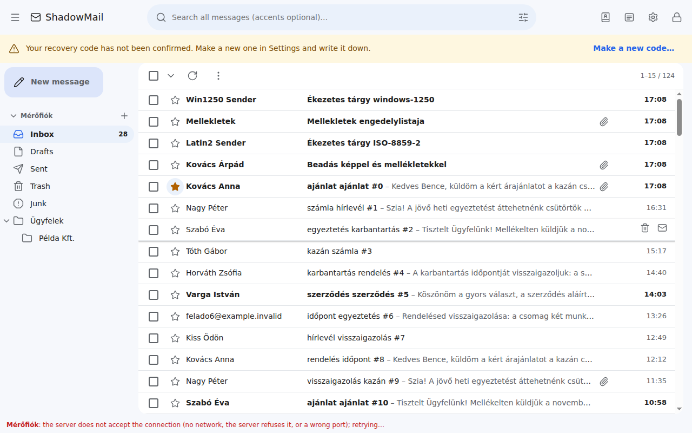
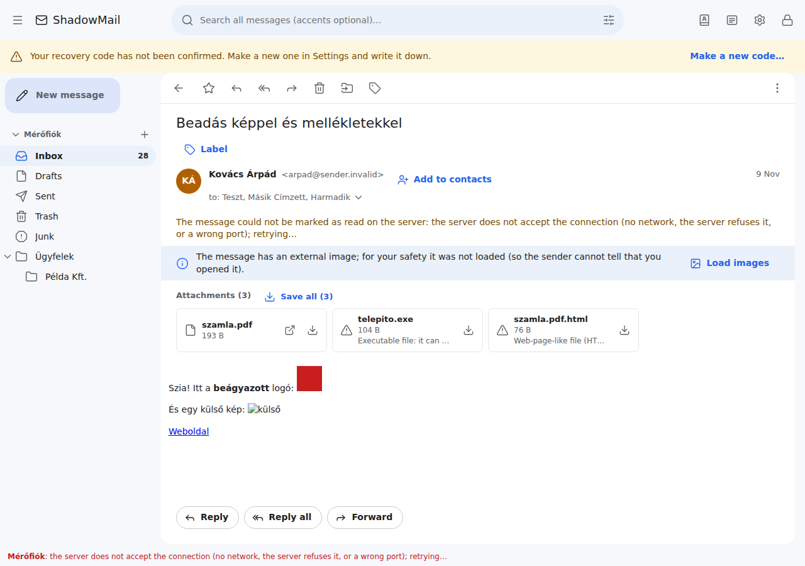
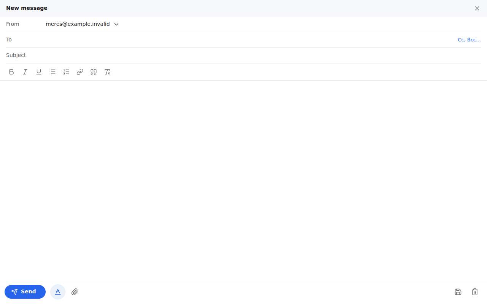
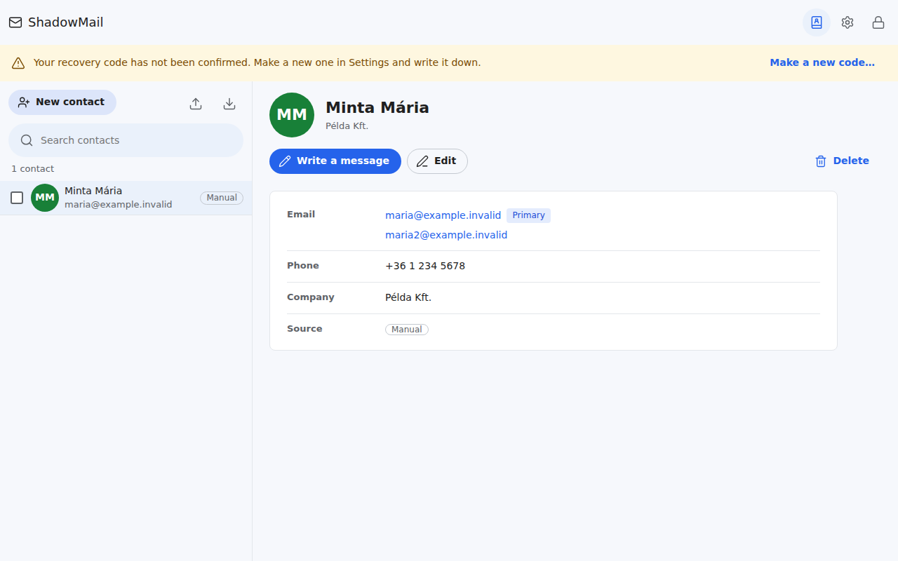
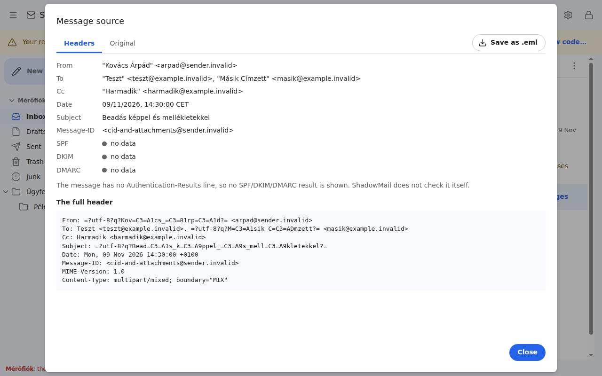
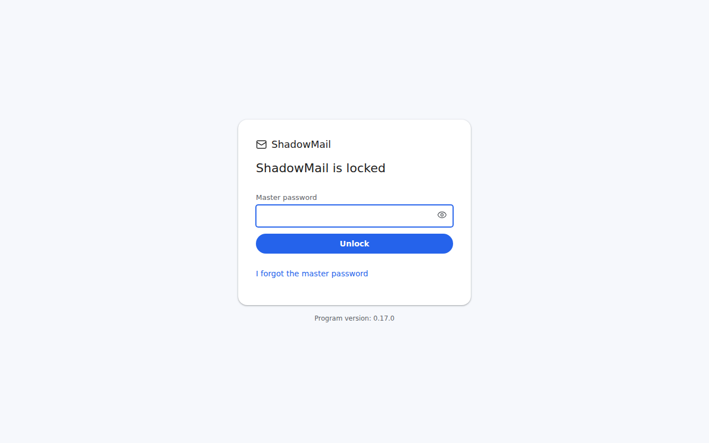
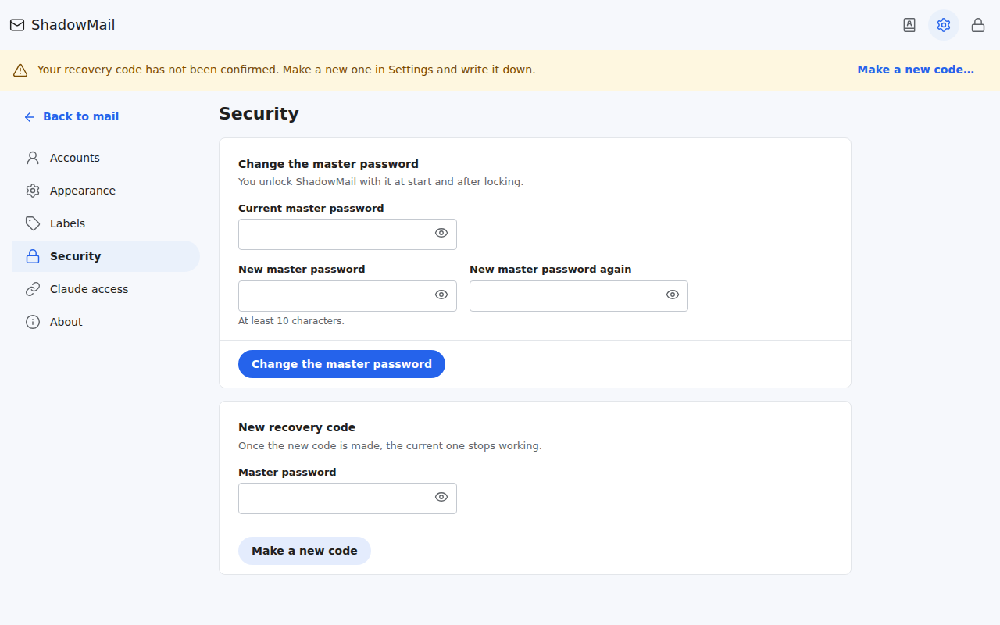
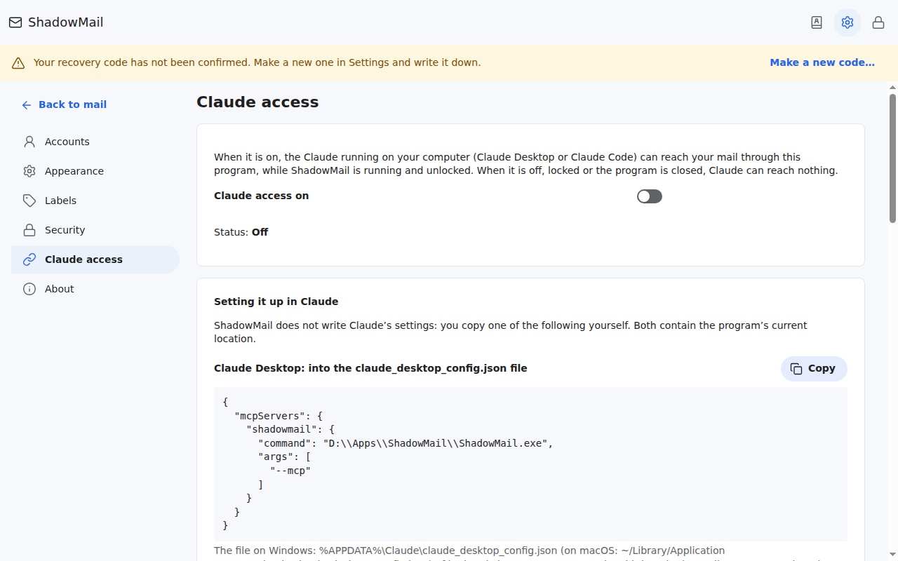

# ShadowMail

[Magyar változat](README.hu.md)

A portable mail client for Windows. No installation: it runs from the folder you unzip it to, and **keeps all its
data in the `data` folder next to the program** (accounts, downloaded mail, search index, settings). It writes
nowhere else on the machine (AppData, Temp, registry), with two exceptions. When the program runs from a USB stick
(FAT/exFAT), **Open** of an attachment puts the file into the Windows temporary folder
(`%TEMP%\ShadowMail\…`), because only there can it be marked as coming from the internet (see Security in brief);
the program empties it on start and on quit. And the Windows **Open/Save** dialog itself remembers in the user
registry which folder you used last (`HKCU\…\Explorer\ComDlg32\LastVisitedPidlMRU`, one entry under the name
`ShadowMail.exe`): Windows writes that, not the program. ShadowMail adds nothing to the Windows "Recent files" list.

The interface is Hungarian by default; Settings / Appearance / Nyelv / Language switches it to English.



(The images are made with test data: `node scripts/ui-screenshots.mjs readme-en --set readme --lang en --out docs/screenshots`.)

## Features

- IMAP and POP3 accounts, several accounts in one program.
- Reading mail: safe HTML display, external images only on request, attachments. With two or more attachments,
  **Save all** saves them all into a folder you choose (never over an existing file: "name (2).ext"; the images
  embedded in the message are left out), then **Show in folder** shows them. If a program or a web-page-like file
  (HTML, SVG, XML) is among the saved ones, a line warns about it.
- Search in every account (also without accents), filters in the folder view too.
- Writing and sending mail (SMTP), reply, forward, folder management.
- **Contacts**: contacts, vCard and CSV import and export.
- The **headers and the original source** of a message.
- **Claude access** (off by default; see below).
- **Hungarian or English** interface, five **themes** (two dark ones and two compact "classic" ones), the reading
  pane on the right, at the bottom or none, switched with one button in the header.
- An **image under the text signature**, per account.
- Accounts and folders in **your own order** (drag, menu or keyboard); a folder **moved** under another one.
- **Shift** on a message's checkbox selects the range from the last checked one.
- **Labels** on messages: several per message, in their own colors, filtering by label; on an IMAP account on the server.
- On Windows, the number of unread messages in a red badge on the taskbar icon (every account's Inbox together, "99+" above 99, none while locked); it can be switched off under Settings / Appearance.
- All data encrypted, with a master password (see First start).





### Keys with a message open

- **Down** / **Up**: the next / previous message of the list (in its current order and filter; in a search, in the
  order of the hits). **PageUp**, **PageDown** and **Space** scroll the message.
- **Delete** deletes, **End** archives (into the account's Archive folder, by year in the yearly mode). With a visible
  selection in the list they act on that, otherwise on the open message. The reader's toolbar has an **Archive**
  button next to Delete. With no message open, Delete deletes the visible selection and End goes to the end of the list.
- After a delete, an archive or a move the **next** message of the list (the one below) opens; after the last one, the
  previous one.
- Where there is nowhere to archive to (the account has no Archive folder, or the message is in it already), End does
  nothing but a line says why.
- The keys work after a click into the message text too. In a text field, a menu, a dialog and on a pane divider they
  keep their usual meaning.

### Keys in the composer

- **Tab** goes from the Subject straight to the message text (the formatting buttons are skipped), **Shift+Tab**
  from the text back to the Subject.
- **Alt+F10** in the text moves to the formatting toolbar: the arrows, **Home** and **End** move between the buttons,
  **Enter** formats, **Esc** goes back to the text (the selection is kept). **Ctrl+B**, **Ctrl+I** and **Ctrl+U** work
  in the text too.
- An image goes into the message from the clipboard (**Ctrl+V**) or dragged onto the text as a file (PNG, JPEG; other
  image formats are attached). Its size is set with a right click on the image, or **Shift+F10** with the caret beside
  it: Small (320 px), Medium (640 px), Large (800 px), Original size, or the image removed. Only the shown width
  changes, not the image itself, and it is never enlarged; **Ctrl+Z** takes it back. Without a size, an image wider
  than 800 px is 800 px wide in the message.

### Filters

The **Filters** button next to the search opens the filter row. Without a search word it filters the
list of the open folder: **Unread**, **Has attachment**, **Starred**,
**Any time** (from a date, to a date). The counter then reads like "1–12 / 28 (filtered, 124 in total)"
(filtered, 124 in all). With a search word the same chips filter the hits.

- The filter **stays when you switch to another folder**, and while it is on, the filter row stays visible.
  **Clear filters** switches all of them off (in the list header, and under an empty filtered
  list). Esc in the search field leaves only the search, not the filters.
- "Select all" and Ctrl+A select **only the filtered messages**, and a delete affects only those.
- A message opened in the Unread filter becomes read but stays in the list until you change the filter, the
  folder or the order, or press **Refresh**.
- The **Account** chip opens the chosen account's Inbox, the **Folder** chip the chosen folder;
  the **Sort** chip is the same as the sorting in the list's **More** menu.

### Address book

The **Contacts** button in the header (next to Settings) opens the contacts; pressed again, it goes
back to the mail.

- **Who is added automatically:** whoever you send mail to (To, Cc, Bcc) is added as an **Automatic**
  contact. The senders of received mail are not added automatically: in an open message you can add
  the sender with the **Add to contacts** button next to the name (not shown for your own
  address).
- **A contact:** display name, given name, family name, company, title, note, several e-mail addresses (one
  primary) and several phone numbers. **New contact**, **Edit**, **Delete**;
  **Write a message** opens a message to the primary address. An address can belong to one contact only.
- **Delete:** the address of a deleted contact is **not added back** automatically at the next send (you can add
  it again by hand). Address completion does not offer it either until you take it back.
- **Import…**: vCard (`.vcf`, 2.1, 3.0, 4.0) or CSV (with the Google and Outlook columns, the
  Hungarian Outlook's too), at most 10 MB and 10 000 contacts. A **preview** comes first: how many new, how many
  merged (the same address in an existing contact: the existing data stays, only empty fields are filled), how
  many unchanged and how many invalid rows; warnings (for example more than 20 addresses in one contact)
  separately. It writes only after you approve, in one step. Photos and web addresses are not imported; the other
  vCard data that cannot be edited here is kept and goes back on export.
- **Export**: all or the selected contacts to a vCard (3.0) or CSV (Google format) file. In the CSV
  the cells that a spreadsheet could take for a formula (starting with `=`, `+`, `-`, `@`) get a `'` in front, so
  they are not run; a phone number like `+36…` is the exception.
- No network: import and export work only with local files. The address book is in the encrypted database.



### Headers and the message source

In the **More** menu of an open message:

- **Headers**: a summary (From, To, Cc, Date, Subject, Message-ID) and the receiving server's check
  results (**SPF**, **DKIM**, **DMARC**: green if passed, red if not, grey in every other case), with the raw
  headers below. The program does **not check these itself**: it reads them from the topmost
  `Authentication-Results` line, written by the server that received the message; so they are for information
  only.
- **Show original**: the whole source of the message as text (up to about 2 million
  characters; the end of a bigger one is not shown, but a save writes the whole message). Invisible and control
  characters are marked (as `⟨U+202E⟩`); the message's HTML and images never show here.
- **Save as .eml**: the whole, original message to a file (named after the subject); the
  program marks the saved file as coming from the internet (see Security in brief).



### Appearance

Under **Settings / Appearance**:

- **Nyelv / Language**: Magyar or English, in effect at once. Without a choice the program is Hungarian, whatever the
  language of Windows. Text that goes to Claude (Claude access) stays Hungarian.
  Open message windows first save their draft and close (one whose save fails stays open), then the main window
  reloads in the new language.
- **Theme**: Default (light), Dark, Graphite, Classic blue, Classic light. The two classic themes have smaller rows
  and buttons; choosing one also sets the reading pane once (Classic blue: on the right, Classic light: at the
  bottom). A message's own HTML is always shown on a white background, in every theme.
- **Reading pane**: on the right of the list, below the list, or none (the message opens in place of the list). The
  **layout button** in the header steps through the three.
- **Unread count on the taskbar icon** (Windows): on by default.

### Signature image

Under **Settings / Accounts**, in a saved account: **Upload image…** puts a PNG or JPG under the text signature (at most
800 x 400 pixels and 150 KB; it is not resized). The image's metadata (for example a GPS location or the author) is
removed when it is saved; an image with a rotation flag is refused (save it rotated and upload it again). In a new
message the image appears under the signature text; it goes out inside the message (not as a link to a web address).
Changing the From account replaces only the signature block, the text you typed stays.

### Order of the accounts and folders

- Drag a folder among its siblings (the folders with the same parent): dropped on the top or bottom edge of a
  sibling, only the order changes. Dragging an account's header among the accounts orders the accounts. Dropping a
  folder on the middle of another folder moves it there (see Moving a folder).
- The same with the right-click menu (**Move up**, **Move down**) or with **Alt+Up** / **Alt+Down** on a folder or
  an account header that has the keyboard focus.
- **Sort folders A-Z** in an account's right-click menu brings back the original order of its folders.
- The order is kept only in ShadowMail: the server and other mail programs do not change. A renamed folder keeps its
  place, a new folder comes at the end of its list.

### Moving a folder

- Drag a folder onto another folder of the same account (the middle of its row): it moves under that folder, with
  its subfolders and messages. Dropped on the account's header, it goes to the top level. The program always asks
  first.
- The same without a mouse: **Move…** in the folder's right-click menu (or **Shift+F10** on the folder) lists the
  places it can go; the arrows, **Home** and **End** choose, **Enter** moves, **Esc** cancels.
- A folder that is the Inbox, Drafts, Sent, Trash, Junk or Archive, or has one of them below it, does not move; nor
  does a folder go into its own subfolder, under the Trash or the Junk, or into another account. The list says why.
- On an IMAP account the server moves the folder in one step: the messages are not downloaded again, and the folders
  you were subscribed to stay subscribed under their new name. On a POP3 account it moves on this computer.

### Selecting messages

- **Shift** with a click on a message's checkbox gives the same state to every message between it and the last
  checkbox you clicked (checks or unchecks the range); the rest of the selection stays.
- **Shift+click** on a row selects the range from the last clicked row, **Ctrl+Shift+click** adds it to the
  selection.
- The range follows the list's order and filter, also the rows not loaded yet; after a new sort or filter it starts
  again from the next checkbox.

### Labels

You can put your own labels (name and color) on messages: in the list, from the right-click menu, from the toolbar of
the selection or from the reader. The **Label** filter chip filters by one; under Settings / Labels you make, rename,
color, order and delete labels.

- **On an IMAP account a label is on the server,** as a keyword on the message (the name encoded, for example
  `sz=c3=a1mla`). Another program (ShadowMail on another computer, another mail client) can see and set it; what it puts
  on or takes off arrives here with the next sync: in the Inbox at once, in other folders at the sync's interval.
- **A label belongs to this copy of the message:** when the same message is in two folders, the copy in the other
  folder does not get it.
- **Name, color and order are on this computer.** In a new data folder (or on another computer) you see the labels on
  the server once you make the label again with the same name. Other programs' own keywords never become labels, and
  the label actions leave them alone.
- **When the server does not allow custom keywords in a folder,** the label is kept on this computer only in that
  folder; the program says so in a line. Edit account / **Test the connection** tells whether the server allows them.
- **Without a connection** (no network, the account stopped) the label does not change, and an error line names the
  account; the messages of the other accounts get it meanwhile.
- **Deleting** a label takes it off the server too, from the messages the program has synced (not from a folder not
  synced yet or not shown). When an account is out of reach, the label stays, it is already off on the other accounts,
  and the deletion can be tried again.
- **Drafts:** a draft saved again keeps its labels; the message sent (its copy in Sent) does not get them.
- **Labels kept only locally before** (a development data folder from before 0.17.0) go to the server after the first
  sync, on every copy of the message.
- **On a POP3 account** a label is kept on this computer and shows on every local copy of the message. When the message
  has no Message-ID and no Date header, a copy downloaded again does not show its label.
- Claude (MCP) can put existing labels on and take them off; only you can make, rename and delete them.

### New in 0.17.0, known limits

- **Labels:** a message can have several labels, each in its own color (12 offered or your own). Put them on with the
  right-click menu's **Labels…**, the selection toolbar's label icon and in the reader; with several messages selected
  the picker shows which label is on all of them and which only on some, and a typed name makes a new label. The list
  shows at most three labels before the subject (colored dots in a narrow list), "+N" for the rest; the reader shows
  all, each with an "x" to take it off. Under **Settings / Labels**: new label, rename, color, order, delete. Details
  above, under **Labels**.
- **On an IMAP account a label is stored on the server** (as a keyword on the message), so another computer or mail
  client can see it; on POP3 on this computer. **Test the connection** tells whether the server allows custom labels,
  and where the account's labels are kept.
- **Label filter:** the folder view's and the search's **Label** chip narrows to one label's messages; **All** in its
  menu turns it off.
- **Claude and labels:** Claude sees the messages' labels, lists and searches by label, and puts existing labels on and
  takes them off without confirmation; only you can make, rename or delete a label.
- **Writing:** Tab in the Subject goes straight to the text (the formatting bar is Alt+F10); typing into an emptied text
  does not carry the old formatting, and making bold text italic shows.
- **Images in a message:** paste an image (**Ctrl+V**) or drop a PNG or JPEG onto the text; it goes out inside the
  message. A right click on it sets its size (320, 640, 800 px, original) or removes it. A photo taken turned is
  turned upright, the signature image too; its location and other metadata are removed.
- **Moving a folder** under another one: drag it onto the folder, or **Move…** in its menu (see Moving a folder).
- **Shift on a checkbox** selects a range of messages (see Selecting messages).
- **Save all:** two or more attachments saved into one folder at once; a program or a web-page-like file (HTML, SVG,
  XML) among them gets a warning.
- The composer's own **Close** button asks before closing an unsaved message, like the window's X.
- On Windows the search field's buttons and the text in one-line fields sit on the middle line; a menu opened near the
  window's edge stays inside the window.

Known limits of this release:

- A photo turned upright loses its color profile (the colors are shown in the standard space). A turned photo larger
  than 50 megapixels is not taken; a photo that does not need turning has no such limit.
- A label's name, color and order are on this computer: in a new data folder or on another computer you see a label
  on the server once you make it again with the same name.
- On an IMAP account a label belongs to that copy of the message: the copy in another folder does not get it. A change
  in another folder (made by another program) comes with the sync's interval, only the Inbox at once.
- Without a connection the label does not change (an error line names the account). A draft saved into another
  account (a From change) does not take its labels from the old account.
- On a POP3 message without a Message-ID the label is bound to the sender, the date and the size; when the message has
  no date either and the program downloads it once more, the new copy does not get its old labels.
- In a 100 000-message folder the first page of a common label's filtered list takes about 0.25-0.5 seconds, and with a
  whole folder selected the label picker opens in about 0.65 seconds.
- With labels, the folder view's chip row may break into two lines in a 1280-pixel-wide window.

### New in 0.16.0, known limits

- **Send later:** the composer's **Send later…** button (today 18:00, tomorrow 8:00, Monday 8:00 or a time of your
  own, in the computer's local time). A scheduled message waits locally, encrypted; its draft leaves Drafts, and it
  goes out ONLY while ShadowMail is running and unlocked. The **Scheduled (N)** list at the top of the sidebar shows
  the scheduled messages of every account: **Open** (edit it in the composer), **Change time**, **Send now**,
  **Unschedule** (back to Drafts). After a temporary error it tries again after 1, 5 and 15 minutes. If the program
  was not running for more than a day at its time (or the computer slept), the message is **missed**: it does not go
  out on its own, you decide. If the program stopped while sending (**interrupted**), or the server did not answer
  after taking the whole message (**uncertain**), the message may have gone out, but that is not certain (a Sent
  copy is made only after a successful send): it is never sent again on its own; **Send now**, and sending it from
  the composer, ask first.
- **Deleting a folder with the server's count:** for an IMAP account the delete warning gives the number of
  messages on the server ("at least N" until it answers); if the server does not answer, the local count stays, as a
  lower bound.
- **Claude's confirmations per action:** under Settings / Claude access / **Confirmations** the confirmation can be
  turned off action by action. With sending turned off, Claude may send without asking only to addresses in your
  address book; for an unknown address, or one with an accented or other non-English letter, the window comes up and
  names it. The recipients of Claude's messages are not added to the address book. A change of the login details
  (server, port, encryption, user name, certificate check) always asks. With the confirmation off, the login of a
  stopped account is restarted on its own only once; after that it asks again until you act (Refresh, saving the
  account, Test connection).
- **Claude can change a draft** (recipients, subject, its own text): the signature, the quote, the forwarded part
  and the attachments stay, and nothing is sent. It runs without confirmation by default (it can be turned on under
  Confirmations); adding a recipient who is not in the address book always asks. A draft open in a compose window is
  not touched.
- **Claude can schedule:** sending a message or a draft can be asked with a time; the confirmation window shows the
  time. Claude can list the scheduled messages and cancel a schedule (the message goes back to Drafts): one it
  scheduled itself without asking, one you scheduled only with your confirmation (this cannot be turned off; one
  Claude scheduled but you changed and saved in the composer counts as yours); a notice shows every cancel. It cannot change the time or the content.
- **Recipient in the Sent and Drafts lists:** in these folders the sender column shows the first recipient's name
  (without a name, the address), "Name +2" with more recipients, the full list under the mouse; with only a blind
  copy (Bcc), that. Sorting there goes by recipient. A name with a comma or a quote is now stored quoted, so the list
  shows it as one recipient.
- **Accented sender and subject from old web forms:** some old form mailers send the sender and the subject without
  encoding, as raw bytes; these showed with broken (�) letters in the list, the reader, the search and the reply's
  quote. Now they are read with the message's own character set (without one, Central European, windows-1250); the
  rows of messages already downloaded are fixed at the next sync.
- **Where a link really goes:** over a link of an HTML message (or on it with Tab) a bar at the bottom left of the
  message shows the real target; if the link's text shows another domain, the bar is a red warning. Details and
  limits: Security in brief.
- **Long plain-text message:** the text scrolls in its own box, the Reply buttons no longer cover it.
- **Search on a loaded computer:** the time limit of the step that makes a large message's search text counts its own
  processor time, not the time passed, so on a loaded computer a large message's text stays out of the search far
  less often (a known limit of 0.15.0). If a downloaded message is still too complex, it is tried once more later, when
  the computer is idle.

Known limits of this release:

- The new features were measured on Linux, not yet on Windows (on the package).
- The handling of instructions hidden in messages (prompt injection) was measured through the program (end to end)
  only with a POP3 account; for an IMAP account a unit test measures it.
- If a scheduled message is being sent when you lock, the lock waits for it at most 10 seconds; if the send takes
  longer, the message shows as interrupted after the next unlock.
- The confirmation window of Claude's folder delete shows the local message count, not the server's.
- In the Sent and Drafts rows stored before 0.16.0 the name is not quoted: a name holding a comma and an address
  ("a@example.example, Real <r@x>") can still give a false first recipient in the list. The reader always shows the
  real recipients.
- The fix of raw-byte headers covers the sender, the subject and the recipients (To, Cc); the blind copy (Bcc) and
  attachment names are not fixed.
- The link bar gives no warning when the link's text is several words ("Log in: bank.example") or hidden; for an
  e-mail (mailto) link the bar does not show the copy and text parts (`?cc=`, `body`).

### New in 0.15.0, known limits

- **Folder roles by hand:** in Settings / Accounts / an IMAP account's editor you can pick the Drafts, Sent, Trash,
  Junk and Archive folder; "Automatic" is the program's own choice. The choice applies at once; nothing changes on
  the server.
- **Archiving by year:** when the Archive has year subfolders (or the account is set so), Archive puts a message
  into the folder of its year and creates a missing year folder.
- **Folding subfolders in the sidebar;** a folded folder's count includes the unread messages of its subfolders.
- **Folder subscriptions:** an IMAP account shows only the folders subscribed on the server; change it in the
  account menu ("Folder subscriptions…") and the folder menu (Unsubscribe). Nothing disappears on the update.
- **Keys on an open message:** Down/Up the next/previous message, Delete deletes, End archives; after a delete or
  archive the next message opens.
- **A new account needs its type (IMAP or POP3) chosen;** it could always be chosen, IMAP was just preselected.
- **One form layout:** the account editor, the address book, Appearance and Security have a new layout (sections,
  fields sized to their content, the Save button always visible; in the address book the family name first and the
  primary address as a radio button).

Known limits of this release:

- If the second move of a yearly archive fails on the server, the list updates only on the next sync; for an
  existing year folder the server may answer "folder exists".
- On a heavily loaded computer the text of a large message may stay out of the search (so since 0.12.0).
- After deleting a message opened in place of the list, the next message opens, not the list.
- The account editor's Archive menu cuts a long choice; in an 860 px wide window the address column of the address
  book editor is narrow.
- The Windows package (ZIP) is checked on Windows before the release; the real Windows taskbar and the keys inside
  an open HTML message were not measured on Linux.

### New in 0.14.1, known limits

0.14.1 is a bugfix release:

- **Folder roles on a mailbox used by several programs.** When the server does not mark which folder is Sent, Trash,
  Drafts and Junk, 0.14.0 took the alphabetically first of the names. So in an account where another program's
  "Elküldött elemek" (Sent Items) folder sits next to "Sent", the built-in Sent pointed to the almost empty folder.
  Now the server's own flag decides; without one, the folder with more messages wins, and the choice is kept. The
  fix takes effect with the first full sync after the update.
- **A bigger number on the taskbar icon:** the digit is about half of the badge, smoothed, on a brighter red.
- **The new message window** opens on the main window's monitor, centered on the main window (until now always on the
  primary display).

Known limits of this release:

- While sending, 0.14.0 put the copy of the message, and on delete the message itself, into the wrong folder on the
  server (for example "Elküldött elemek", "Törölt elemek"). These messages **stay there**: 0.14.1 moves nothing on
  the server; they can be moved by hand.
- The **real Windows taskbar** and a **two-monitor** setup were not measured before the release; only the image the
  program draws and the computed position.
- On a second display at 125%, the new message window may stick out of the display by a few pixels (Electron's
  rounding).

### New in 0.14.0, known limits

0.14.0 brings everything listed above since 0.12.0: the English interface, the themes and the layout button, the
signature image, the account and folder order, the unread count on the taskbar icon, an **Edit** button on a message
in Drafts, a message list that stays readable when narrow, faster folder counts in the sidebar, no freeze on very
large table messages, and the question before replying to a message whose writing direction changes very often (see "Replying to
a broken or harmful message").

Known limits of this release:

- The 0.14.0 Windows package was **not run before the release**: its tests ran on Linux (the owner's decision).
- The **taskbar badge on a real Windows taskbar** was not checked; only the image the program draws was measured.

## Download and start

The latest version: [github.com/arnyek/ShadowMail/releases/latest](https://github.com/arnyek/ShadowMail/releases/latest)
(the `ShadowMail-<version>-win-x64.zip` file under Assets).

1. Unzip `ShadowMail-<version>-win-x64.zip` into a **local** folder, for example `D:\Programs\ShadowMail`, or onto
   a USB stick.
2. Start `ShadowMail.exe`.

### Windows SmartScreen

The program is not digitally signed, so on the first start Windows may warn ("Windows protected your PC"). Then:
**More info**, and **Run anyway**. This is needed only once.

## First start: the master password

On the first start you set a **master password** (at least 10 characters, twice). It encrypts the whole mail
store in the `data` folder: the account passwords, the database (message list, search index) and the downloaded
messages. You unlock the program with it on every start, on any machine.



### The recovery code

After the master password the program shows a **recovery code** (25 characters in groups of five, for example
`7K3QD-…`). With it you can get in if you forget the master password. **Write it down or save it** (**Copy**,
**Save to file**), and keep it in a safe place, apart from the computer and the USB stick.
You can go on only after typing back one group of the code. Whoever gets the code opens your mail without the
master password. The program does not store the code; if it is lost, **Make a new code** on the
**Security** tab of **Accounts and settings** makes a new one (with the master password), and the old one
stops working with the current `vault.json`. If the code screen closes without confirming, a bar reminds you after
the next unlock.

After **Copy** the code stays on the clipboard for 60 seconds: then, on lock and on quit the program
clears it, but only if exactly the code is still there (what you copied meanwhile from elsewhere is left alone). On
Windows the code goes neither into the clipboard history (Win+V) nor to the cloud clipboard.

**The old code and the old password, together with an earlier backup of the data folder, still open the mail.**
Changing the code, recovering with the code and changing the password only rewrite the `data\vault.json` file; the
key of the messages stays the same. An earlier copy of `vault.json` (for example in an older backup of the data
folder) therefore opens today's database and messages with the old code or the old master password. **If the code
or the password got into the wrong hands, destroy the old backups too.**



### If you forget the master password

On the unlock screen, **I forgot the master password**, two ways:

- **I have a recovery code**: the code (case, spaces and hyphens do not matter; I and L =
  1, O = 0) and a new master password twice. **Nothing is lost.** You then get a new code, and the used one stops
  working with the current `vault.json` (with an old backup see above).
- **I have no code**: a full reset. **All local data is lost**: the accounts and their passwords,
  the search index, the POP3 messages, the local folders, the drafts and Sent copies kept only locally. IMAP mail
  is downloaded again from the server once the account is added again. To confirm, type the word `DELETE`,
  then a new master password twice. Without its key the old data cannot be read, so it can be deleted.

**Write down the master password and the code too, and keep them safe.**

### An interrupted reset

If the machine stops during a **I have no code** reset, the program finishes or undoes it on the next
start. If it cannot tell for sure how far it got, it deletes nothing on its own: the unlock screen says so and
offers **Finish starting over**. That is the same as the **I have no code** way (`DELETE`, a new
master password twice): **all local data is deleted**, and an empty program with a new code follows. If you want
to keep anything, **copy the whole `data` folder** first, with the program closed.

The **Lock** button forgets the key at once: the open message windows save their drafts first and close,
the sync stops, and the database closes until you unlock again.

## Adding an account

**Accounts and settings** → **New account**. You need: the server name, its port, the security
mode (SSL/TLS, STARTTLS, or no encryption), the user name and the password, and the SMTP (sending) details.
**Test the connection** checks them before you save.

- **Indexed messages** (in the Sync section, 3 years by default): for older messages only the
  header (sender, subject) can be searched locally; their text can be searched with "Search on the server too"
  (IMAP) or "Search the text of old messages too" (POP3).
  What you opened once always stays searchable.
- **The local search looks in the VISIBLE text of a message**: in an HTML message in what the reader shows (a hidden
  preheader, white on white, `display:none` are left out), in a plain-text message in its text. The list preview
  shows the hidden preheader. Only the first 128 KB of a too complex HTML message is searchable; if that is too
  complex as well, only its subject and sender. "Search on the server too" is the SERVER's search in the whole
  message: it may find hidden text too.
- **POP3**: messages stay on the server by default; with "Delete from the server after N days (empty =
  never)" the program deletes them from the server N days after the download (they stay on the machine).
  Some servers (e.g. Dovecot) mark a message read on the server when POP3 downloads it. If you also look at the same
  mailbox over IMAP (webmail, phone), the downloaded messages show as read there.
- **Wrong password**: if the server refuses the login, the program does **not retry that account on its own** (many
  servers block the machine after a few failed attempts). Correct the password in the account settings, or press
  **Refresh**.

## Data folder, backup, update

All data is in the `data` folder next to `ShadowMail.exe`. **Backup: with the program closed, copy the whole `data`
folder** (for example to another drive). Restore: copy the saved `data` folder next to `ShadowMail.exe`.

- `data\mail.sqlite`: accounts (with encrypted passwords), message data, search index
- `data\store\`: the downloaded messages (.eml, encrypted)
- `data\tmp\`: opened attachments; emptied on start and on quit
- `data\electron\`: the program's own internal data and logs

### Updating to a new version

There are two ways. For both, **close the program** first.

**A) Into a new folder (recommended)**

1. Close the program.
2. Unzip the new version into a **new** folder.
3. Move the `data` folder from the old folder next to the new `ShadowMail.exe`. On the same drive **moving** is
   enough (Cut, then Paste: instant, even for a big folder); no need to copy.
4. Start the new one. The old folder stays untouched, at hand for going back.

**B) Over the old folder (overwriting)**

1. **Close the program.** Here this is a must: with the program running the unzip succeeds only partly (the running
   program's files are locked), and PowerShell's `Expand-Archive` reports that with error lines but returns success.
   If the unzip shows an error or "the file is being used by another process", close the program and unzip again.
2. If there is room, copy the `data` folder first; this is optional, the program's own backup (`.bak`) is enough for
   going back.
3. Unzip the new version into the old folder, replacing the files (Explorer: "Replace the files in the destination";
   PowerShell: `Expand-Archive -Force`). The `data` folder stays where it is.
4. Start it.

The risk: no untouched old program folder is left (going back needs the old zip); if a future version drops a file,
the old one may stay in the folder.

### When the database structure changes

Then the program converts the database on the first unlock, and saves the old one first:
`data\mail.sqlite.bak-<old structure>`. While it converts, the unlock screen says so.

- The backup is a copy of **the database only** (`data\mail.sqlite`): the downloaded messages (`data\store`) are not
  in it; the program does not change them.
- It is made only when the structure changes, and is **never deleted on its own**. Do not delete it until the new
  version has proved good; you may delete it then.
- It is about as big as the database: free space of the size of `mail.sqlite` is needed. If there is not enough,
  the unlock says so and nothing changes.
- If the program closed during the conversion (or you stopped it), start it again: the backup and the conversion
  start over, the data is not damaged.

An older program neither opens nor changes the data folder of a newer version (the unlock screen says so). **Going
back to an older version:** close the program; in the `data` folder delete `mail.sqlite`, `mail.sqlite-wal` and
`mail.sqlite-shm`, and copy `mail.sqlite.bak-<N>` to `mail.sqlite`; then start the older version. The backup is the
state at the moment of the conversion: what happened since (new messages, flags) is not in it. For an IMAP account
the messages come down again with the next sync; for a POP3 account a message downloaded since and already deleted
from the server may be lost.

### What NOT to do

- **Do not run it from a network drive or from a cloud-synced folder** (OneDrive, Dropbox, Google Drive): the
  database can get damaged there.
- **Do not use the same `data` folder on two machines at the same time** (for example on a shared network folder).
  On one machine two copies with the same `data` folder do not start; the second only brings the first to the front.
- Do not put it under `Program Files`: the program cannot write there, so it quits with an error message.

## Security in brief

- The HTML of a message shows in an isolated frame: no program (script) can run in it, external images load only
  on **Load images**, and only in that message.
- **Where a link really goes**: with the mouse over a link of an HTML message (or the link focused with Tab) a small
  bar at the bottom left of the message shows its real target, the domain in bold. If the link's text itself looks
  like an address (`bank.example`, `https://...`) and points to another domain, the bar turns red: "Warning: the link
  goes somewhere else than its text shows", with the real host. A subdomain of the same domain (`www.`, `login.`) is not
  a difference; an international (punycode, `xn--`) address shows in letters too. Limits: the domain is compared with a
  short built-in list of two-level endings (`co.uk`, `com.au`, `co.hu`...), not the full public list, so two sites under
  a missing ending count as one; when several links of a message share a target, a text of any of them counts; a
  plain-text message has no clickable links, so no bar either.
- **Open** is offered only for these types: PDF (`.pdf`), image (`.jpg .jpeg .png .gif .bmp .webp .tif
  .tiff`), text (`.txt`), Office (`.doc .docx .xls .xlsx .ppt .pptx`), OpenDocument (`.odt .ods .odp`). **Everything
  else can only be saved** (for example Office files with macros, `.rtf`, `.csv`, the slide shows `.pps .ppsx`,
  archives and every unknown type): save it with **Save…**, and open it from there if you trust it. So an
  unknown or rare, dangerous type does not start with one click either. Executable attachments (.exe, .bat, .js,
  ...) and files active in a browser (.html, .svg, .xml, ...) can only be saved, with their own reason shown; with a
  double extension (`invoice.pdf.exe`) the last one counts.
- The program **marks an opened or saved attachment as coming from the internet** (the Windows "Mark-of-the-Web").
  So Office opens such a document in **Protected View**, and it can be edited after **Enable Editing**; for a
  downloaded program Windows warns. This is on purpose: a macro or malicious attachment does not run by itself. When
  the program runs from a USB stick (exFAT/FAT32), where the mark cannot be written, an opened attachment opens
  marked from the Windows temporary folder (`%TEMP%\ShadowMail`); if it cannot be marked there either, the program
  does not open it: save it and open it from there. **Save as** to such a drive saves without the mark (FAT/exFAT
  cannot store it).
- The program does not look for a proxy (WPAD) on start. Behind a company proxy **Load images**
  therefore does not work; mail (IMAP, POP3, SMTP) is not affected.

### Replying to a broken or harmful message

The body of a message can be put together, on purpose or by mistake, so that the editor cannot show it (for example
one single paragraph of several hundred thousand characters without a break: an "e-mail bomb"). The program does
not freeze then:

- **Before Reply, Reply all, Forward** the program looks at what the editor
  would get. If it finds one unbroken piece of text longer than 40 000 characters, or one paragraph whose writing
  direction (left to right, right to left, digits) changes more than 50 000 times, the editor window does not even
  show; the main window asks: **Without the quote** (the editor opens with the usual "... wrote:"
  line, or with the forwarded message's header, and one line says where the original text was left out; a forward
  keeps the attachments unchanged) or **Cancel**. Such a draft, or a mail link, does not open (only Cancel
  can be chosen).
- **If the editor does not open within 5 seconds** (for any reason, also for a new message and a mail link), the
  program closes it and says why in the main window. No draft is made then, and the original message does not
  change.

Known limit: quoting a very long HTML paragraph without breaks is not solved; such a message can be answered only
without the quote. If a message stays under both limits above and the editor still cannot show it, the watchdog
closes the editor (after about 5 seconds), nothing freezes.

## Claude access (MCP)

Claude running on your machine (Claude Desktop or Claude Code) can read and manage your mail through ShadowMail
(Model Context Protocol). **It is off by default.** Even when switched on, it is reachable only while ShadowMail
runs and is unlocked: locked, with the program closed or with the switch off, Claude reaches nothing.



### Switching it on

1. **Accounts and settings → Claude access**, and tick **Claude access on**. The state: **Off**,
   **Waiting (no Claude connected)** or **Connected: N**.
2. On the same page, copy the setting for Claude with **Copy**. The text holds the program's **current
   location**. ShadowMail does not write Claude's settings; you paste this yourself.
   - **Claude Desktop:** into `claude_desktop_config.json`, under `mcpServers`. The file is at
     `%APPDATA%\Claude\claude_desktop_config.json` on Windows, at `~/Library/Application Support/Claude/claude_desktop_config.json`
     on macOS. If the file already has `mcpServers`, add only the `shadowmail` part. After saving, restart Claude
     Desktop. This is how it looks with the program in `C:\ShadowMail` (in JSON every `\` is doubled):

     ```json
     {
       "mcpServers": {
         "shadowmail": {
           "command": "C:\\ShadowMail\\ShadowMail.exe",
           "args": [
             "--mcp"
           ]
         }
       }
     }
     ```

   - **Claude Code:** type the command into a terminal (PowerShell or Command Prompt). With `--scope user` it is
     available in every project; in Claude Code the `/mcp` command shows whether it connected.

     ```
     claude mcp add --transport stdio --scope user shadowmail -- "C:\ShadowMail\ShadowMail.exe" --mcp
     ```

3. **If you moved the ShadowMail folder, paste the setting again**: Claude looks for the program at the old place.

The setting's format is from the official documentation: Claude Desktop:
<https://modelcontextprotocol.io/docs/develop/connect-local-servers>, Claude Code: <https://code.claude.com/docs/en/mcp>.

### What can Claude do?

- **Without confirmation:** reading and searching (a message does not become read by this), flags (read, star),
  moving, moving to the Trash, creating and renaming a folder, writing a draft (into Drafts, marked "Claude"; the
  program shows a notice), changing a draft (it sends nothing; it can be made to ask under Confirmations), listing
  the scheduled messages and cancelling a message Claude scheduled (back to Drafts, with a notice), refresh, testing an account's connection,
  showing a message or a search in the program's window, listing the labels, seeing the messages' labels and
  filtering by a label, putting an existing label on and taking it off (the window shows it at once). These can be
  undone.
- **Only with your confirmation:** sending or scheduling a message, deleting for good, deleting a folder or an
  account, changing an account's settings, restarting the login of a stopped account, cancelling your own scheduled
  message. Under **Confirmations** these
  can be turned off action by action (see the rules in New in 0.16.0); a change of the login details and cancelling your own scheduled message always ask.
  Then the ShadowMail window comes to the front and
  shows exactly what would happen (for a send: the recipients, the text and the real target of every link). The
  default button is **Reject** (Enter rejects too), **Approve** becomes active after one
  and a half seconds. The request expires after 10 minutes. From the confirmation window, **Lock** or
  **Reject all, turn Claude access off** rejects everything in one step.
- **Never:** passwords, the master password and the recovery code, the content of attachments, attaching a local
  file, the Claude access switch, and making, renaming or deleting a label (only you can, under Settings / Labels).

The **Recent Claude calls** list on the same page shows the last 20 calls (time, tool,
result, count). The list is in memory only and is empty after a lock or a restart. No search word, address, subject
or message text goes into it, nor into the log.

**Mind this:** the text of a message is outside data. An instruction hidden in a message may try to get Claude to do
something; ShadowMail hands that text to Claude marked as such, and the dangerous actions need your confirmation.
The protection is against other programs on your machine and against instructions hidden in mail; this switch does
not protect against malware running as your user. **In Claude, keep the approval prompts of web and other tools on**,
because an instruction hidden in a message could try to take data out through them.

**The filtering of hidden text is not complete.** From a message's HTML, ShadowMail gives Claude the text the
program's reader shows: it filters the parts hidden with CSS (`display:none`, `visibility:hidden`, a font size of 0
or very small, a transparent colour or the background's, off-screen, zero size, `clip`, `scale(0)`, a closed
`<details>`), with the rules of `<style>` blocks in the browser's order. On purpose it does NOT filter (because the
reader shows it too, or because it cannot be decided for sure): rules under `@media` and rules with attribute or
non-structural pseudo selectors (`[data-x]`, `:hover`), `mso-hide`, `aria-hidden` and `<font size="1">`, and the
items of a drop-down list. The local search (the search index) uses the same visible text; it finds the above there
too.

## Building from source

On Windows, to make `ShadowMail-<version>-win-x64.zip`:

1. Install **Node.js** 22.22.2 or a newer 22.x, 24.15.0 or a newer 24.x, or 26 or newer (<https://nodejs.org/>), and **Git**.
2. Get the source: `git clone <the repository's address>`, then `cd` into the folder.
3. `npm ci` (the exact dependencies of `package-lock.json`).
4. `npm test` (the unit tests; all must pass).
5. `npm run dist:win`
6. The package: `dist\ShadowMail-<version>-win-x64.zip`; the unpacked program can also be tried in
   `dist\win-unpacked`.

For development, `npm start` runs the program from the source (data folder: `data-dev`). The layout, the tests and
the rules for contributing: [CONTRIBUTING.md](CONTRIBUTING.md).

## Troubleshooting (not for daily use)

- `SHADOWMAIL_DATA=<folder>` environment variable: the program uses the given data folder instead of `data`.
- `SHADOWMAIL_SMOKE=1`: a self-check mode (after the window shows, it writes a short report under
  `data\electron\logs` and quits). Made for checking the package.
- Logs: `data\electron\logs\main.log`, the network guard's log: `data\electron\logs\net-guard.log`.

## License

Copyright (C) 2026 arnyek

ShadowMail is free software: you can redistribute it and/or modify it under the terms of the GNU General Public
License as published by the Free Software Foundation, either version 3 of the License, or (at your option) any later
version (`GPL-3.0-or-later`). It is distributed in the hope that it will be useful, but **WITHOUT ANY WARRANTY**;
see the [LICENSE](LICENSE) file for details.

The third-party packages it uses and their licenses: [THIRD-PARTY-NOTICES.txt](THIRD-PARTY-NOTICES.txt).
